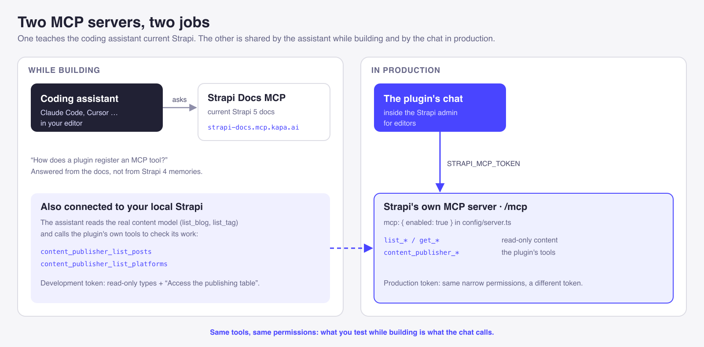
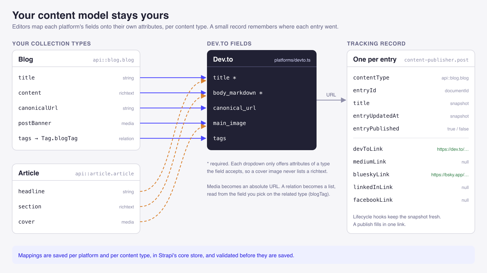
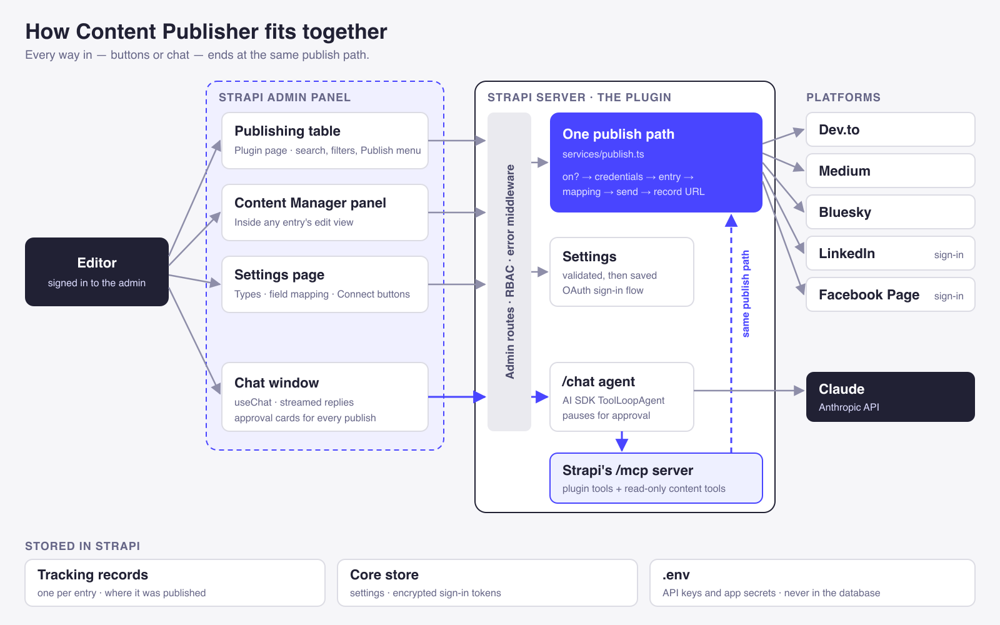
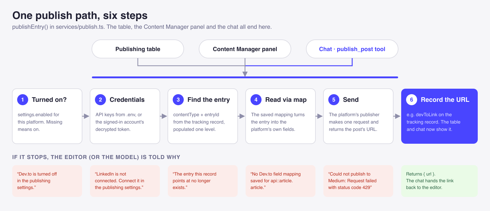
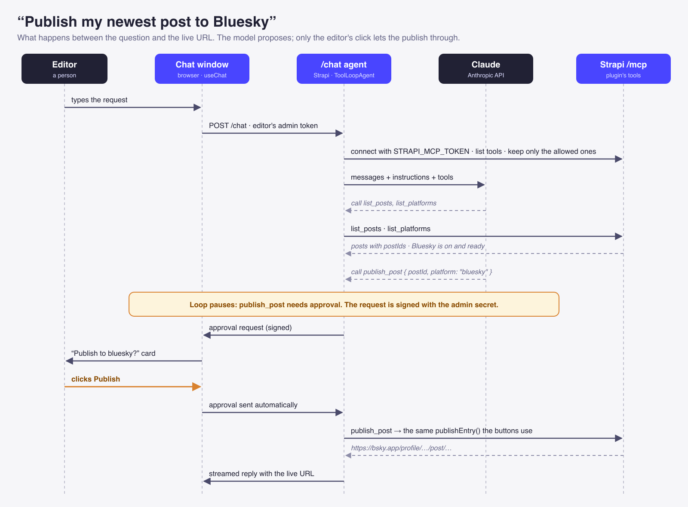

*Content Publisher: the publishing table, with the assistant open and answering "Which posts are not on Dev.to yet?"*

I wanted to write a post once in Strapi and have it reach every place my readers are, without pasting it into five different websites.

That sounds simple. It isn't. Every platform wants a different shape of content and a different kind of credential, and each has its own rules about what you can post. And once a post is out, somebody has to remember where it went.

So I built **Content Publisher**, a Strapi 5 plugin. It publishes entries from the admin panel to **Dev.to, Medium, Bluesky, LinkedIn and Facebook**, and keeps a record of where each one ended up. Then I added a chat. An editor can ask "what hasn't gone to LinkedIn yet?" or "publish my newest post to Bluesky", and the assistant does it through the same code the buttons use. **Nothing is published until a person clicks Publish.**

This post is mostly about the *why*: the decisions, the trade-offs, and what building an agent inside a CMS taught me. It also explains *how* each part works, with the real code from the repo, trimmed so each snippet shows one idea.

- **Repo:** [github.com/Theodore-Kelechukwu-Onyejiaku/custom-strapi-plugin](https://github.com/Theodore-Kelechukwu-Onyejiaku/custom-strapi-plugin)
- **Package:** `npm install content-publisher`

## Table of contents

1. [The problem](#the-problem)
2. [What I was thinking](#what-i-was-thinking)
3. [Use cases and the business case](#use-cases-and-the-business-case)
4. [The tech stack, and why I picked it](#the-tech-stack-and-why-i-picked-it)
5. [Before any code: two MCP servers](#before-any-code-two-mcp-servers)
6. [How the plugin works: a tour](#how-the-plugin-works-a-tour)
7. [Architecture](#architecture)
8. [How it's built: the why behind each piece](#how-its-built-the-why-behind-each-piece)
9. [Adding the AI: building an agentic system inside a CMS](#adding-the-ai-building-an-agentic-system-inside-a-cms)
10. [A new way of building](#a-new-way-of-building)
11. [Deployment](#deployment)
12. [Known limitations](#known-limitations)
13. [What I learned](#what-i-learned)
14. [Use this post with your AI assistant](#use-this-post-with-your-ai-assistant)

## The problem

Here's how cross-posting usually works on a content team.

You publish a post on your own site. Then someone opens Dev.to, pastes in the Markdown, fixes the images that broke because they were relative URLs, re-adds the tags, and remembers to set the canonical URL so search engines credit the original. Then Medium, with its own tags. Then a short version for Bluesky, under 300 characters. Then a LinkedIn share. Then the company Facebook Page.

Three weeks later someone asks: "Did the Hono article ever go to Medium?" Nobody knows. Someone checks by hand.

The usual fixes each cost something:

- **Social scheduling tools** handle the short platforms well, but they don't understand your content model. They don't know your `body` field is Markdown, or that your tags live in a relation.
- **Zapier-style automations** are brittle. Rename one field in the CMS and the automation quietly sends empty posts.
- **Custom scripts** work until the person who wrote them leaves.

All three also put your content and your credentials in yet another system.

I wanted publishing that lives *where the content already lives*, understands how it's structured, and remembers what it did.

## What I was thinking

Before writing code, I settled on six principles. Every later decision came back to them.

1. **Strapi is the source of truth.** The content is already modelled there, so the record of where it was published belongs there too. No second database, no outside dashboard.
2. **A plugin, not a service.** A plugin installs with `npm install`, runs inside Strapi, uses Strapi's permissions, and disappears with `npm uninstall`. Nobody has to host anything new.
3. **Platforms are data, not code.** Adding a platform should mean *describing* it, not editing the admin UI. The settings page should build itself from that description.
4. **Secrets never touch the database.** API keys live in `.env` only. There is deliberately no text box to paste one into.
5. **The AI uses the same doors as people.** The chat can't do anything the publishing table can't. It calls the same service, behind the same permission.
6. **Anything you can't undo stays with a person.** Publishing is public and permanent. The model can *propose* a publish. Only an editor can *approve* one.

The first four make the plugin trustworthy without the AI. The last two keep it trustworthy *with* the AI.

## Use cases and the business case

Three situations shaped what the plugin does:

- **Launch day.** A DevRel team publishes a tutorial in Strapi. The editor opens the chat, types "publish the Hono tutorial everywhere it isn't yet", and approves five cards. Each platform gets its own shape: the full article with a canonical URL on Dev.to and Medium, a link card on Bluesky, a share on LinkedIn and the company Page.
- **The quarterly audit.** A content lead asks "which posts from this year never went to Medium?" and gets a table back in seconds, not an afternoon of clicking.
- **The new hire.** An editor joins mid-quarter. Their role lets them publish, but not see credentials or change where content goes. Onboarding is "here's the Publish button".

| Who | What they get |
| --- | --- |
| **DevRel and content teams** | One view of which posts reached which platforms, and one click, or one sentence, to fill the gaps |
| **Agencies** running Strapi for clients | Cross-posting they install per project, with each client's credentials in that client's own `.env` |
| **Solo creators** | Reach on Dev.to, Medium and Bluesky without paying for a scheduling tool, and a canonical URL that points home |
| **Ops and security** | No keys in the database, encrypted sign-in tokens, and three separate permissions |

Posting to five places isn't new. The value is that publishing becomes **part of the content workflow** instead of a chore after it, and that there is a **record** everyone can see.

## The tech stack, and why I picked it

| Piece | Choice | Why |
| --- | --- | --- |
| Host | **Strapi 5 plugin** | Runs where the content is, reuses Strapi's admin, permissions, database and encryption |
| Admin UI | **Strapi Design System** and the admin's own `Table`, `Filters`, `SearchInput`, `Pagination` | The plugin looks and behaves like the rest of the admin, with no design work |
| Tools for the AI | **Strapi's built-in MCP server** (`/mcp`) | Tools get Strapi's permissions for free, and any MCP client can use them |
| Agent | **Vercel AI SDK**: `ai`, `@ai-sdk/anthropic`, `@ai-sdk/mcp`, `@ai-sdk/react` | One library for the agent loop, the MCP client, tool approval, and streaming into React |
| Model | **Claude**, set with `ANTHROPIC_MODEL` | Strong at tool use. The model is one env var, so cost is a setting, not a rewrite |
| Chat replies | **react-markdown** with **remark-gfm** | Tables and links in replies, and raw HTML is ignored |
| Platform calls | **axios** | One small HTTP request per platform. No SDKs to keep up to date |
| Secrets | **`.env`** for API keys, **Strapi's encryption service** for sign-in tokens | Keys stay out of the database. Tokens issued at runtime are stored encrypted |

## Before any code: two MCP servers

I set up two MCP servers before writing the first line. They do different jobs, and the second one ended up at the heart of the product.


*Two MCP servers. The docs server is for building only. Strapi's own server is shared by the coding assistant and the chat.*

### Strapi Docs MCP: build for Strapi 5, not Strapi 4

**Why:** Strapi 5 changed a lot. The Document Service replaced the Entity Service, entries are addressed by `documentId`, and plugins adding MCP tools is brand new. A coding assistant has seen years of Strapi 4 code and only a little Strapi 5, so left alone it reaches for the old patterns. With the docs server connected, a question like "how does a plugin register an MCP tool?" is answered from the current docs, not from memory.

It's a hosted server with no key. In Claude Code:

```bash
claude mcp add --transport http strapi-docs https://strapi-docs.mcp.kapa.ai
```

The same URL works in Cursor, Claude Desktop, or any client that supports remote MCP servers.

### Strapi's own MCP server: the same interface for building and running

Strapi 5 ships an MCP server. It turns your content types into tools (`list_blog`, `get_tag` …), and plugins can add their own.

**1. Turn it on.**

```ts
// config/server.ts
export default ({ env }) => ({
  host: env('HOST', '0.0.0.0'),
  port: env.int('PORT', 1337),
  app: { keys: env.array('APP_KEYS') },
  mcp: { enabled: true },
});
```

**2. Create an admin token** under *Settings → Administration Panel → Admin Tokens*. Give it read access to your publishable content types and the plugin's **Access the publishing table** permission. Nothing else.


*The token the assistant and the chat use. Read-only content, plus the one plugin permission.*

**3. Connect your coding assistant.** I keep both servers in a project `.mcp.json`. The setup is shared with the repo, but the token comes from the environment and is never committed:

```json
{
  "mcpServers": {
    "strapi-docs": { "type": "http", "url": "https://strapi-docs.mcp.kapa.ai" },
    "strapi": {
      "type": "http",
      "url": "http://localhost:1337/mcp",
      "headers": { "Authorization": "Bearer ${STRAPI_MCP_TOKEN}" }
    }
  }
}
```


*Both servers connected in Claude Code. The plugin's three tools appear under `strapi` once the plugin is running.*

**Why this mattered while building:** the assistant could look at real data instead of guessing. It listed the actual blogs and tags to learn the content model. Once the plugin's tools existed, it called `content_publisher_list_posts` itself to check its work against the database.

**Why it mattered for the product:** the chat inside the admin panel connects to *the same server*, with the same kind of token. The tools I tested from my editor are exactly the tools an editor's chat calls.

## How the plugin works: a tour

Before the internals, here is what an editor actually does, start to finish.

### 1. Choose what you publish from

In **Content Publisher → Publishing settings**, the editor picks the collection types they publish from: Blog, Article, Tutorial, whatever the project has. The plugin immediately creates a tracking record for every existing entry of those types.


*Step 1: pick the collection types to publish from. Existing entries show up in the table straight away.*

### 2. Map each platform's fields onto your attributes

Each platform is an accordion row. Open Dev.to and you see what Dev.to's API needs (title, content, canonical URL, cover image, tags), each with a dropdown of *your* attributes. The dropdowns only offer attributes of a matching type, so "Cover image" lists media fields and nothing else. Pick a relation like `tags`, and a second dropdown asks which field on the related type holds the tag text.


*Step 2: map Dev.to's fields onto your Blog attributes. Each content type gets its own mapping.*


*Mappings are per platform and per content type, so a Blog's `content` and an Article's `section` can both feed Dev.to's `body_markdown`.*

### 3. Add credentials, or sign in

For Dev.to, Medium and Bluesky, the editor sees each required env var as **Set in .env** or **Missing**, and a **Test connection** button that checks the keys against the platform without publishing anything.


*API keys are read from `.env` and never shown. "Test connection" makes a read-only call to the platform.*

LinkedIn and Facebook use sign-in instead. The editor clicks **Connect LinkedIn**, signs in in a popup, and the card shows who is connected and when the token expires. For Facebook, they also pick which Page to post as.


*Sign-in platforms show the connected account and its expiry. The token itself never reaches the browser.*

### 4. Publish from the table, or from the entry

The plugin's main page lists every published entry. One cell shows an icon per platform, full colour where the post already is and faded where it isn't. The **Publish** menu offers only the platforms that entry hasn't reached, plus *Everywhere remaining*.


*Step 4: the publishing table. Each row has one status cell and one Publish menu, however many platforms are on.*

The same menu sits inside every entry's edit view, so editors can publish without leaving the post they just wrote.


*The Content Manager panel. Published platforms link to the live post. The rest offer "Publish to …".*

### 5. Or just ask

The floating button opens the publishing assistant. It can answer questions about what's been published where, and it can publish, with the editor approving each one. More on this in [Adding the AI](#adding-the-ai-building-an-agentic-system-inside-a-cms).

## Architecture


*Every way in, buttons or chat, ends at the same publish path.*

There are five layers:

1. **Platform definitions.** One small file per platform describing the fields its API wants and the env vars it needs.
2. **Settings.** Which collection types you publish from, and each platform's field mapping. Stored in Strapi's core store, the same place Upload and i18n keep their settings.
3. **Tracking records.** One per entry, holding a snapshot of the title and the URL on each platform.
4. **One publish path.** Every publish, from any surface, goes through the same function.
5. **Ways in.** The table, the Content Manager panel, and the chat. The chat reaches the publish path through MCP tools.

Here is how that maps onto the plugin's folders:

```
content-publisher/
├── admin/src/
│   ├── components/          table, settings page, Content Manager panel, chat UI
│   └── hooks/               one hook per action: usePublishRow, usePlatformMapping …
└── server/src/
    ├── platforms/           one file per platform: its fields and env vars
    ├── content-types/       the tracking record
    ├── register.ts          lifecycle hooks + MCP tool registration
    ├── routes/ controllers/ thin: admin routes behind RBAC
    ├── services/
    │   ├── publish.ts       the one publish path
    │   ├── resolve-fields.ts  reads an entry through a mapping
    │   ├── publishers/      one request per platform
    │   ├── oauth/           LinkedIn and Facebook sign-in
    │   └── chat/            the agent and its MCP connection
    └── mcp/                 the three tools the AI can call
```

The most important part of the diagram is the middle. There is **one** way to publish. The chat didn't get its own.

## How it's built: the why behind each piece

### 1. A tracking record for any collection type

The first version only worked with a collection called `Blog`. The tracking record had a *relation* to `api::blog.blog`, so it couldn't point at anything else. Real projects have `Article`, `Post`, `Tutorial`, `CaseStudy`, so the relation became two plain columns, a content type uid and a document id, plus a few snapshot fields.

```ts
// server/src/content-types/post.ts (trimmed)
const schema = {
  kind: 'collectionType',
  collectionName: 'posts',
  info: { singularName: 'post', pluralName: 'posts', displayName: 'Post' },
  options: { draftAndPublish: false },
  // internal to the plugin: hidden from the Content Manager and Content-Type Builder
  pluginOptions: {
    'content-manager': { visible: false },
    'content-type-builder': { visible: false },
  },
  attributes: {
    // which entry this record tracks: a uid and documentId, not a relation
    contentType: { type: 'string' },
    entryId: { type: 'string' },
    // snapshots, so listing and searching stay one query on this table
    title: { type: 'string' },
    entryUpdatedAt: { type: 'datetime' },
    entryPublished: { type: 'boolean', default: false },
    // where it went
    devToLink: { type: 'text' },
    mediumLink: { type: 'text' },
    blueskyLink: { type: 'text' },
    linkedInLink: { type: 'text' },
    facebookLink: { type: 'text' },
  },
};
```

**Why snapshots?** The table needs titles to list, sort and search. Without a snapshot, each row would be a lookup into a different content type. With one, the whole table is a single query on one table.

**Why a flag instead of deleting?** When an entry is unpublished, its record stays with `entryPublished: false`. The record holds the URLs of everywhere the post already went. Losing those because someone moved an entry back to draft would be destructive.

> **In the repo:** `server/src/content-types/post.ts`

### 2. Keeping records in sync with lifecycle hooks

The records follow their entries through Strapi's database lifecycle hooks. The subscription deliberately has **no model filter**: which types are publishable is a runtime setting, so a fixed list would go stale the moment an editor ticked a new type.

```ts
// server/src/register.ts (trimmed)
const register = ({ strapi }) => {
  // also stops us reacting to our own writes, which would recurse
  const isTracked = async (uid: string) => {
    if (uid === POST_UID) return false;
    const { contentTypes } = await getSettings(strapi);
    return contentTypes.includes(uid);
  };

  const sync = async (event) => {
    const uid = event.model?.uid;
    if (await isTracked(uid)) {
      await onEntryChanged(strapi, uid, event.result);
    }
  };

  strapi.db.lifecycles.subscribe({
    afterCreate: sync,
    afterUpdate: sync,

    // A delete is either the whole entry going, or only its published row on
    // unpublish. Look the document up again before deciding which.
    async afterDelete(event) {
      const uid = event.model?.uid;
      if (uid === POST_UID) return;

      const documentId = event.result?.documentId;
      const stillThere = await strapi.documents(uid).findOne({ documentId });

      if (stillThere) await onEntryChanged(strapi, uid, stillThere);
      else await onEntryRemoved(strapi, uid, documentId);
    },
  });

  registerMcpTools(strapi);
};
```

There is one Strapi 5 detail worth knowing. With draft & publish, a document has two rows: the draft and the published version. Editing a published entry fires on the *draft* row, which always has `publishedAt: null`. If the handler trusted that row, every edit would mark the entry unpublished. So it asks the Document Service for the real state:

```ts
// server/src/services/tracking.ts
export const publishedVersion = async (strapi, uid: string, documentId: string) => {
  const contentType: any = (strapi.contentTypes as any)[uid];
  const status = contentType?.options?.draftAndPublish ? { status: 'published' as const } : {};

  return strapi.documents(uid as any).findOne({ documentId, ...status });
};
```

Lifecycles only see changes. Entries that existed *before* a type was ticked are picked up by a backfill (`syncTrackingRecords`) that runs at boot and right after the collection types are saved. It's idempotent, so running it twice changes nothing.

> **In the repo:** `server/src/register.ts`, `services/tracking-sync.ts`, `services/tracking.ts`, `services/backfill.ts`

### 3. Platforms are descriptions

Each platform is a plain object: the fields its API expects, which Strapi attribute types can feed each field, and which env vars it needs.

```ts
// server/src/platforms/devto.ts
const devTo: Platform = {
  key: 'devTo',
  label: 'Dev.to',
  envVars: ['DEVTO_API_KEY'],
  fields: [
    { key: 'title', label: 'Title', required: true, accepts: ['string', 'text'] },
    {
      key: 'body_markdown',
      label: 'Content',
      required: true,
      accepts: ['string', 'text', 'richtext'],
      hint: 'Front matter inside this field overrides the values mapped below.',
    },
    { key: 'canonical_url', label: 'Canonical URL', required: false, accepts: ['string', 'text', 'uid'] },
    { key: 'main_image', label: 'Cover image', required: false, accepts: ['media'] },
    {
      key: 'tags',
      label: 'Tags',
      required: false,
      accepts: ['relation'],
      hint: 'Pick the relation, then which of its fields holds the tag text.',
    },
    { key: 'description', label: 'Description', required: false, accepts: ['string', 'text'] },
  ],
};
```

LinkedIn and Facebook add one line, `oauth: { scopes: [...] }`. That switches their settings card from "credentials" to a **Connect** button.

**Why this matters:** the server sends this list to the settings page, and the page builds every dropdown from it. The UI has no idea Dev.to exists. Adding a sixth platform means writing one of these files and the request that sends it.

> **In the repo:** `server/src/platforms/`

### 4. Settings in the core store, validated on the way in

Settings are configuration, not content, so they live in Strapi's core store rather than a content type:

```ts
// server/src/services/settings-store.ts
const store = (strapi) =>
  strapi.store({ type: 'plugin', name: 'content-publisher', key: 'settings' });

// merges a patch into what is saved, so saving one part never clobbers another
export const saveSettings = async (strapi, patch: Partial<Settings>) => {
  const next: Settings = { ...(await getSettings(strapi)), ...patch };
  await store(strapi).set({ value: next });
  return next;
};
```

The core store accepts any JSON. That's convenient, and dangerous: a mistyped attribute name would save fine and only fail weeks later at publish time, with an error nowhere near the cause. So every mapping is checked before it's saved:

```ts
// server/src/services/mapping-validator.ts (trimmed)
for (const [uid, fieldMap] of Object.entries(value)) {
  if (!isCollectionType(strapi, uid)) {
    throw new ValidationError(`"${uid}" is not a collection type`);
  }
  const contentType = getContentType(strapi, uid);

  for (const [key, name] of Object.entries(fieldMap ?? {})) {
    if (name === null || name === '') continue; // unmapped optional field

    const isItem = key.endsWith(ITEM_SUFFIX); // e.g. tags__item
    const fieldKey = isItem ? key.slice(0, -ITEM_SUFFIX.length) : key;

    if (!fieldKeys.has(fieldKey)) {
      throw new ValidationError(`"${fieldKey}" is not a ${platform.label} field`);
    }
    if (isItem) checkItem(strapi, contentType, fieldMap, fieldKey, name);
    else if (!contentType.attributes?.[name]) {
      throw new ValidationError(`"${name}" does not exist on ${uid}`);
    }
  }
}
```

The error message reaches the settings page as-is, so the editor sees *which* attribute was wrong.

> **In the repo:** `server/src/services/settings-store.ts`, `services/mapping-validator.ts`, `services/setting-writes.ts`

### 5. Reading an entry through the mapping

At publish time, a resolver turns an entry into a plain object keyed by the platform's own field names. It decides what to do from the attribute's **type**, not its name:

```ts
// server/src/services/resolve-fields.ts (trimmed)

// Uploads are stored relative ("/uploads/x.png"), which Dev.to and Medium can't fetch.
const mediaUrl = (media, strapi): string | null => {
  const url = media?.url;
  if (!url) return null;
  if (/^https?:\/\//i.test(url)) return url; // S3, Cloudinary … already absolute
  return `${strapi.config.get('server.absoluteUrl', '')}${url}`;
};

// A relation becomes a list of text, read from the attribute picked for `<field>__item`
const relationValues = (raw, itemName: string | null): string[] => {
  if (!itemName) return [];
  const list = Array.isArray(raw) ? raw : raw ? [raw] : [];
  return list.map((item) => item?.[itemName]).filter(Boolean);
};

const readValue = (strapi, attributes, fieldMap, field, entry, name) => {
  const type = attributes?.[name]?.type;
  const raw = entry?.[name];

  if (type === 'media') return mediaUrl(raw, strapi);
  if (type === 'relation') return relationValues(raw, fieldMap[`${field.key}${ITEM_SUFFIX}`]);
  return raw ?? null;
};
```

The `mediaUrl` function fixes a real problem. Without it, Dev.to and Medium are handed `/uploads/x.png`, a path only your own server understands, and the cover image never appears.

The publishers never learn which attribute a value came from. They receive `{ title, body_markdown, main_image, tags, … }` and nothing else.

> **In the repo:** `server/src/services/resolve-fields.ts`, `services/publish-source.ts`

### 6. One publish path for everything

This is the function every surface ends up calling: the table, the Content Manager panel, and the chat.


*Six steps, and a readable reason whenever one stops.*

```ts
// server/src/services/publish.ts
export const publishEntry = async (strapi, post, platformKey: string, send: Send) => {
  const platform = getPlatform(platformKey);
  if (!platform) {
    throw new ApplicationError(`"${platformKey}" is not a known platform.`);
  }

  const settings = await getSettings(strapi);

  // a missing flag means enabled; only an explicit false turns a platform off
  if (settings.enabled?.[platformKey] === false) {
    throw new ApplicationError(`${platform.label} is turned off in the publishing settings.`);
  }

  // an API key, or for LinkedIn and Facebook the signed-in account's token
  const secrets = await secretsFor(strapi, settings, platform);

  const { uid, entry, fieldMap } = await resolveSource(strapi, post, platform, settings);
  const url = await send(resolveFields(strapi, uid, platform, fieldMap, entry), secrets);

  await strapi.documents(POST_UID).update({
    documentId: post.documentId,
    data: { [LINK_FIELDS[platformKey]]: url }, // devTo -> devToLink
  });

  return { url };
};
```

Each platform only supplies `send`: one function that takes the resolved values and the secrets, makes one request, and returns the URL. Here's Dev.to's:

```ts
// server/src/services/publishers/devto.ts (trimmed)
export const sendToDevTo = async (values, secrets): Promise<string> => {
  const article = {
    title: values.title,
    body_markdown: values.body_markdown,
    published: true,
    main_image: values.main_image,
    canonical_url: values.canonical_url,
    description: excerpt(values.description),
    tags: values.tags ?? [],
  };

  try {
    const response = await axios.post(
      'https://dev.to/api/articles',
      { article },
      { headers: { 'api-key': secrets.DEVTO_API_KEY } }
    );
    return response.data?.url;
  } catch (error) {
    return publishFailed('Dev.to', error); // throws with the platform's own message
  }
};
```

Wiring it up is a single line:

```ts
// server/src/services/service.ts
async publishPostToDevTo(post) {
  return publishEntry(strapi, post, 'devTo', sendToDevTo);
},
```

**Why this matters later:** when I added the AI, I didn't have to teach it how to publish. I only had to give it a way to call this function.

> **In the repo:** `server/src/services/publish.ts`, `services/publishers/`, `services/service.ts`

### 7. Respecting that platforms aren't all blogs

The *path* is shared. The *payload* is each platform's own. Forcing one shape on all five would have made every one of them worse.

**Bluesky is not a blog.** A post is at most 300 graphemes *and* 3,000 UTF-8 bytes, and those are different limits: 299 family emoji are 299 graphemes but around 10,000 bytes. So the text is cut on grapheme boundaries and checked against both caps, and a link card points back to the full post.

```ts
// server/src/services/publishers/bluesky/text.ts (trimmed)
const MAX_GRAPHEMES = 300;
const MAX_BYTES = 3000;
const ELLIPSIS = '…';

export const fitToPost = (text: string) => {
  const graphemes = graphemesOf(text); // Intl.Segmenter, so an emoji counts as one
  const withinBoth =
    graphemes.length <= MAX_GRAPHEMES && Buffer.byteLength(text, 'utf8') <= MAX_BYTES;

  if (withinBoth) return text;

  const budget = MAX_BYTES - Buffer.byteLength(ELLIPSIS, 'utf8');
  return clampBytes(graphemes.slice(0, MAX_GRAPHEMES - 1), budget) + ELLIPSIS;
};
```

**LinkedIn's text is markup.** Characters like `[`, `(` and `#` mean something in LinkedIn's "little" text format. An unescaped bracket in a title can make LinkedIn drop the rest of the post, so they're escaped first:

```ts
// server/src/services/publishers/linkedin.ts
const escapeLittle = (text: string) => text.replace(/[\\|{}@\[\]()<>#*_~]/g, '\\$&');
```

**LinkedIn and Facebook sign in instead of using keys.** The flow is the familiar "Connect" popup. The callback route can't require an admin login (LinkedIn is what calls it), so a one-time, ten-minute `state` value proves the request started in this admin panel:

```ts
// server/src/services/oauth/state.ts (trimmed)
export const createState = async (strapi, platform: string, redirectUri: string) => {
  const state = crypto.randomBytes(24).toString('hex');
  const all = fresh(await load(strapi)); // drops expired ones

  all[state] = { platform, redirectUri, expiresAt: Date.now() + TTL_MS };
  await store(strapi).set({ value: all });
  return state;
};

// Returns the pending sign-in and deletes it, so the same state can never be replayed.
export const consumeState = async (strapi, state: unknown, platform: string) => {
  if (typeof state !== 'string') return null;

  const all = fresh(await load(strapi));
  const pending = all[state];
  delete all[state];
  await store(strapi).set({ value: all });

  return pending?.platform === platform ? pending : null;
};
```

The token that comes back is encrypted with Strapi's own encryption service before it's stored. If no encryption key is configured, the plugin **refuses** to save it rather than storing it in plain text:

```ts
// server/src/services/credentials.ts
export const encryptValue = (strapi, value: string): string => {
  const encrypted = encryption(strapi)?.encrypt(value);
  if (!encrypted) {
    throw new ValidationError(
      'Cannot store a sign-in token until an encryption key is configured. ...'
    );
  }
  return encrypted;
};
```

> **In the repo:** `server/src/services/publishers/bluesky/`, `publishers/linkedin.ts`, `services/oauth/`

### 8. Secrets: `.env` only, and the browser learns only "set" or "missing"

API keys are read from the environment and nowhere else:

```ts
// server/src/services/credentials.ts
export const resolveSecrets = (platform: Platform) => {
  const secrets: Record<string, string | undefined> = {};
  for (const name of platform.envVars) {
    secrets[name] = process.env[name] || undefined;
  }
  return secrets;
};
```

What the settings page receives is a yes or no per variable, never any part of the value:

```ts
// server/src/services/present-settings.ts
const summarise = (platform: Platform) => {
  const secrets = resolveSecrets(platform);
  return Object.fromEntries(
    platform.envVars.map((name) => [name, { configured: Boolean(secrets[name]) }])
  );
};
```

**Why so strict?** A key pasted into a form ends up in the database, in every backup of it, and in the next screenshot someone shares. Not offering a box is the simplest way to make sure that never happens.

> **In the repo:** `server/src/services/credentials.ts`, `services/present-settings.ts`

### 9. Three permissions, not one

The plugin registers three RBAC actions at boot:

| Action | Grants |
| --- | --- |
| Access the publishing table | The menu link, the table, the Content Manager panel, and the chat |
| Access the publishing settings | Viewing mappings and credential status |
| Change the publishing settings | Saving mappings, switching platforms on and off, Connect |

Seeing what you *can* publish shouldn't mean seeing *where* it goes or *which* credentials exist. Every route builds its config from one helper:

```ts
// server/src/routes/can.ts
export const can = (action: string) => ({
  policies: [
    'admin::isAuthenticatedAdmin',
    { name: 'admin::hasPermissions', config: { actions: [action] } },
  ],
  middlewares: ['plugin::content-publisher.plugin-errors'],
});

// server/src/routes/settings.ts
{ method: 'PUT', path: '/settings/platforms/:platform', handler: 'setting.updatePlatform',
  config: can(SETTINGS_UPDATE) },
```

One gotcha: the action names use **dashes, not dots**. The admin's `useRBAC` hook names its flags from the last dot-separated part of the action. `settings.update` would arrive as `canUpdate`, and `settings.read` would collide with `read`. With `settings-update` you get the `canSettingsUpdate` the settings page checks.


*An editor role that can publish, but can't see or change where content goes.*

> **In the repo:** `server/src/permissions.ts`, `routes/`, `admin/src/permissions.ts`

### 10. Errors that actually reach the person

Early on, a perfectly good error like "Could not publish to Medium: Request failed with status code 429" only ever reached the terminal. The browser got a bare 500 with no body.

The cause was subtle. Strapi's error middleware recognises its own errors with `instanceof`. A plugin resolves its own copy of `@strapi/utils`, so its error classes are different objects from the ones the host checks against. The check fails and the message is lost. The fix matches on `error.name` instead:

```ts
// server/src/middlewares/plugin-errors.ts (trimmed)
export default (_config, { strapi }) => async (ctx, next) => {
  try {
    await next();
  } catch (error: any) {
    const recognised = KNOWN.has(error?.name);
    const status = recognised ? (STATUS_BY_NAME[error.name] ?? 400) : 500;

    if (!recognised) strapi.log.error(error); // a real bug: log it, don't echo it

    ctx.status = status;
    ctx.body = {
      data: null,
      error: {
        status,
        name: recognised ? error.name : 'InternalServerError',
        message: recognised ? error.message : 'Internal Server Error',
        details: error?.details ?? {},
      },
    };
  }
};
```

This mattered twice. Editors see *why* a publish failed. Later, the AI sees it too, and can tell the editor what to fix.

> **In the repo:** `server/src/middlewares/plugin-errors.ts`

### 11. An admin UI that feels native

The table is built from the admin's own components: `Table`, `Filters`, `SearchInput` and `Pagination`, the same ones the Content Manager list view uses. They keep their state in the URL, so the hook just forwards the query string to the server:

```ts
// admin/src/hooks/usePostsQuery.ts (trimmed)
export const usePostsQuery = () => {
  const { get, del } = useFetchClient();
  const [{ rawQuery }] = useQueryParams(); // ?page=2&sort=title:asc&_q=hono …

  const load = useCallback(async () => {
    setIsLoading(true);
    try {
      const { data } = await get(`/content-publisher/posts${rawQuery}`);
      setPosts(data.posts ?? []);
      setPagination(data.pagination ?? EMPTY_PAGINATION);
    } finally {
      setIsLoading(false);
    }
  }, [get, rawQuery]);

  // refetches on every sort, filter, search and page change
  useEffect(() => { load(); }, [load]);
};
```

The server only honours columns it knows. It always adds `entryPublished: true`, because a draft isn't something you can syndicate:

```ts
// server/src/services/list-query.ts (trimmed)
const FILTERABLE = ['title', 'contentType', ...Object.values(LINK_FIELDS)];

const cleanFilters = (query) => {
  const and = Array.isArray(query?.filters?.$and) ? query.filters.$and : [];
  const kept = and.filter((one) => Object.keys(one ?? {}).every((key) => FILTERABLE.includes(key)));

  const search = decode(query?._q);
  if (search) kept.push({ title: { $containsi: search } });

  kept.push({ entryPublished: { $eq: true } }); // not overridable from the query
  return { $and: kept };
};
```

Sorting, filters, search and the page survive a refresh, work with the back button, and can be shared as a link, with no state code in the plugin.

> **In the repo:** `admin/src/components/PublishingTable.tsx`, `admin/src/hooks/usePostsQuery.ts`, `server/src/services/list-query.ts`

## Adding the AI: building an agentic system inside a CMS

At this point the plugin worked. Then I asked a different question: what if editors didn't have to know where the buttons are?

"Which posts aren't on Dev.to yet?" takes a filter, a scan and some mental bookkeeping in the table. In a chat, it takes one sentence.


*The assistant opens with starter questions. Clicking one sends it.*

But a chat that can *publish* can make public, permanent mistakes. So the design started from what the AI should **not** be able to do, and worked outward.


*The whole round trip. The model proposes the publish; the editor's click is what lets it through.*

### The AI's abilities are three MCP tools

The plugin adds three tools to Strapi's MCP server:

| Tool | What it does |
| --- | --- |
| `content_publisher_list_posts` | Tracked entries and the URL on each platform (`null` = not there yet) |
| `content_publisher_list_platforms` | Which platforms are on, and if one isn't ready, *why* |
| `content_publisher_publish_post` | Publishes one post to one platform |

The publish tool is a thin wrapper over the same service the table calls:

```ts
// server/src/mcp/publish-post.ts
export default ai.mcp.defineTool({
  name: 'content_publisher_publish_post',
  title: 'Publish a post to a platform',
  description:
    'Publishes one post (by postId from content_publisher_list_posts) to one platform. ' +
    'This is public and cannot be undone, so only call it when the editor has asked ' +
    'for that exact post and platform.',
  auth: AUTH, // the "Access the publishing table" permission
  resolveInputSchema: () =>
    z.object({
      postId: z.string().describe('postId from content_publisher_list_posts'),
      platform: z.enum(PLATFORM_KEYS).describe('Platform key'),
    }),
  resolveOutputSchema: () => z.object({ platform: z.string(), url: z.string() }),
  createHandler: (strapi) => async ({ args }) => {
    const post: any = await strapi.documents(POST_UID).findOne({ documentId: args.postId });
    if (!post) return failed(`No post with id ${args.postId}.`);

    if (post[LINK_FIELDS[args.platform]]) {
      return failed(`"${post.title}" is already on ${args.platform}: ${post[LINK_FIELDS[args.platform]]}`);
    }

    try {
      const service: any = strapi.plugin('content-publisher').service('service');
      const { url } = await service[PUBLISHERS[args.platform]](post);
      return ok(`Published "${post.title}" to ${args.platform}: ${url}`, {
        platform: args.platform,
        url: String(url),
      });
    } catch (error: any) {
      return failed(error?.message ?? `Could not publish to ${args.platform}.`);
    }
  },
});
```

`list_platforms` reuses the publish path's own credential check, so its explanation is the same one a failed publish would give:

```ts
// server/src/mcp/list-platforms.ts (handler)
const platforms = await Promise.all(
  PLATFORMS.map(async (platform) => {
    // the same check publishing makes; its error already says what is missing
    const problem = await secretsFor(strapi, settings, platform)
      .then(() => null)
      .catch((error) => String(error?.message ?? 'Not set up.'));

    return {
      key: platform.key,
      label: platform.label,
      enabled: settings.enabled?.[platform.key] !== false,
      ready: problem === null,
      problem,
    };
  })
);
```

**Why MCP, and not a private function call?**

1. **Permissions come for free.** Each tool is gated by the same RBAC action as the table. A token without "Access the publishing table" never sees the tools.
2. **Any client can use them.** Claude Desktop, Cursor or your own agent can connect to `/mcp` and get the same three tools. The chat is one client, not the only one.
3. **The AI's abilities are visible.** The list of tools *is* the list of things the AI can do.

Two details only showed up in testing.

**Register in `register()`, never `bootstrap()`.** Strapi only accepts new tools while its MCP server is idle:

```ts
// server/src/mcp/index.ts
export const registerMcpTools = (strapi) => {
  const mcp = (strapi as any).ai?.mcp;
  if (!mcp?.isEnabled?.()) return; // MCP is off unless enabled in config/server

  mcp.registerTool(listPosts);
  mcp.registerTool(listPlatforms);
  mcp.registerTool(publishPost);
};
```

**Put the data in the text, too.** The AI SDK's MCP client hands the model only the *text* of a tool result. My first version returned "11 post(s)." as text and the rows as structured data, so the model knew how many posts there were but had no IDs to publish with:

```ts
// server/src/mcp/shared.ts
export const ok = (text: string, data) => ({
  content: [{ type: 'text', text: `${text}\n${JSON.stringify(data)}` }],
  structuredContent: data,
});
```

> **In the repo:** `server/src/mcp/`

### A fixed tool list, filtered in code

The chat's agent runs on the server. It connects to Strapi's own `/mcp` with an admin token, and then **filters** the tools it gets back:

```ts
// server/src/services/chat/mcp-tools.ts (trimmed)

// Read-only Content Manager tools (list_blog, get_tag …) plus the plugin's own.
// No create, update or delete tools, and nothing touching user accounts.
const isAllowed = (name: string) =>
  TOOL_NAMES.includes(name) || (/^(list|get)_/.test(name) && !name.includes('users-permissions'));

export const openMcpTools = async (strapi) => {
  const token = process.env.STRAPI_MCP_TOKEN;
  if (!token) throw new ApplicationError('Add STRAPI_MCP_TOKEN (an admin token) to the .env file ...');

  const client = await createMCPClient({
    transport: {
      type: 'http',
      url: `${strapi.config.get('server.absoluteUrl')}/mcp`,
      headers: { Authorization: `Bearer ${token}` },
    },
  });

  try {
    const all = await client.tools();

    // Strapi hides tools from a token that lacks permission, silently. Say so.
    if (!(TOOL_NAMES[0] in all)) throw new ApplicationError(MISSING_PERMISSION);

    const tools = Object.fromEntries(Object.entries(all).filter(([name]) => isAllowed(name)));
    return { client, tools };
  } catch (error) {
    await client.close();
    throw error;
  }
};
```

So the model can read posts and tags, but the *only* thing it can change is "publish this post to this platform". The write tools aren't forbidden in the prompt. **They're never given to the model.**

The permission check matters too. Without it, a token missing one checkbox makes the model say "I can't publish", and nobody knows why. With it, the chat says exactly which permission to tick on which token.

> **In the repo:** `server/src/services/chat/mcp-tools.ts`

### The agent: a loop, a step limit, and an approval gate

```ts
// server/src/services/chat/agent.ts (trimmed)
const INSTRUCTIONS = `You are the assistant inside Strapi's Content Publisher plugin.
You help editors see which entries have been published where, and publish them to
Dev.to, Medium, Bluesky, LinkedIn and Facebook.

- Look things up with the tools rather than guessing. content_publisher_list_posts gives
  each post's postId and where it is already published.
- Before publishing, check content_publisher_list_platforms. If a platform is off or not
  ready, say why instead of trying.
- Only call content_publisher_publish_post for a post and platform the editor asked for.
  The editor approves each publish in the chat; if they deny it, do not retry.
- After publishing, give the editor the URL. Keep answers short.`;

export const createChatAgent = async (strapi) => {
  const apiKey = process.env.ANTHROPIC_API_KEY;
  if (!apiKey) throw new ApplicationError('Add ANTHROPIC_API_KEY to the .env file and restart Strapi.');

  const { client, tools } = await openMcpTools(strapi);
  const anthropic = createAnthropic({ apiKey });

  const agent = new ToolLoopAgent({
    model: anthropic(process.env.ANTHROPIC_MODEL || DEFAULT_MODEL),
    instructions: INSTRUCTIONS,
    tools,
    // enough to list, check and publish to a few platforms; stops a runaway loop
    stopWhen: stepCountIs(12),
    maxOutputTokens: 8192,
    // publishing is public and permanent, so the editor confirms every call
    toolApproval: { content_publisher_publish_post: 'user-approval' },
    // signs approval requests so a browser can't forge an "approved" answer
    experimental_toolApprovalSecret: String(strapi.config.get('admin.auth.secret')),
  });

  return { agent, client };
};
```

Two lines do most of the safety work:

- **`toolApproval`** pauses the loop whenever the model calls the publish tool. An approval request streams to the browser, and nothing runs until an answer comes back.
- **`experimental_toolApprovalSecret`** signs that request with the admin secret. Someone crafting a request in the browser can't fake an "approved".

The instructions *guide* the model. The tool list and the approval gate *constrain* it. The guardrails don't depend on the model following the prompt.

### Streaming the answer

The controller checks everything it can *before* streaming starts. Once the stream begins, an error can no longer become a clean JSON response:

```ts
// server/src/controllers/chat.ts
async send(ctx) {
  const messages = ctx.request.body?.messages;
  if (!Array.isArray(messages)) {
    throw new ValidationError('messages must be an array of chat messages');
  }

  // a missing API key or MCP token throws here, while a readable JSON error is still possible
  const { agent, client } = await createChatAgent(strapi);

  ctx.respond = false; // from here the AI SDK writes the response itself
  try {
    await pipeAgentUIStreamToResponse({
      response: ctx.res,
      agent,
      uiMessages: messages,
      onFinish: () => client.close(),
      // the detail goes to the server log; the browser gets a generic line
      onError: (error) => {
        strapi.log.error('[content-publisher] chat error', error);
        return 'The assistant ran into an error. Check the Strapi logs for details.';
      },
    });
  } catch (error) {
    await client.close();
    throw error;
  }
},
```

The `/chat` route sits behind the same `read` permission as the table: `config: can(READ)`. **The chat can do nothing the table doesn't already let that editor do.**

> **In the repo:** `server/src/controllers/chat.ts`, `routes/chat.ts`

### The chat window

On the admin side, the AI SDK's `useChat` does the heavy lifting. The hook adds two things: the editor's admin token on every request (read fresh each time, since Strapi refreshes it in the background), and carrying on automatically once the editor answers an approval:

```ts
// admin/src/hooks/usePublisherChat.ts
export const usePublisherChat = () => {
  const token = useAuth('PublisherChat', (auth) => auth.token);
  const tokenRef = useRef(token);
  tokenRef.current = token;

  const transport = useMemo(
    () =>
      new DefaultChatTransport({
        api: chatUrl(),
        headers: () => ({ Authorization: `Bearer ${tokenRef.current}` }),
      }),
    []
  );

  return useChat({
    transport,
    // once the editor approves or denies a publish, continue without pressing send
    sendAutomaticallyWhen: lastAssistantMessageIsCompleteWithApprovalResponses,
  });
};
```

An approval request renders as a card, not as text:

```tsx
// admin/src/components/chat/ToolCall.tsx (trimmed)
const Approval = ({ part, onRespond }) => (
  <Box padding={3} hasRadius background="warning100" borderColor="warning200">
    <Typography variant="omega" fontWeight="bold">
      {`Publish to ${part.input?.platform}?`}
    </Typography>
    <Typography variant="pi" textColor="neutral600">
      {`Post ${part.input?.postId}. This is public and can't be undone.`}
    </Typography>
    <Flex gap={2}>
      <Button size="S" onClick={() => onRespond(part.approval.id, true)}>Publish</Button>
      <Button size="S" variant="tertiary" onClick={() => onRespond(part.approval.id, false)}>
        Cancel
      </Button>
    </Flex>
  </Box>
);
```


*The approval card. The agent is paused until the editor clicks.*


*After approval: the publish runs through the same path as the buttons, and the reply links to the live post.*

### Show progress in words, never fake it

While the agent works, the chat shows what it's actually doing: "Thinking…", then "Looking up posts…", then "✓ Looked up posts". Each label comes from the real state of the stream:

```ts
// admin/src/components/chat/activity.ts (trimmed)
const LABELS = {
  content_publisher_list_posts: { active: 'Looking up posts', done: 'Looked up posts' },
  content_publisher_list_platforms: { active: 'Checking platforms', done: 'Checked platforms' },
  content_publisher_publish_post: { active: 'Publishing', done: 'Published' },
};

// "Thinking…" while waiting for the first reply, while the model reasons, and between steps.
export const isThinking = (messages, status) => {
  if (status === 'submitted') return true;
  if (status !== 'streaming') return false;

  const last = messages[messages.length - 1];
  const part = last?.parts?.[last.parts.length - 1];
  if (!part || part.type === 'step-start' || part.type === 'reasoning') return true;
  return isToolPart(part) && part.state?.startsWith('output');
};
```

The model's reasoning itself is never shown. Replies render as Markdown with `react-markdown`, which ignores raw HTML, so text the model read out of a blog post can't inject anything into the admin panel.


*Questions that take several clicks in the table come back as a short answer, here a Markdown table.*

### The guardrails, in one table

| Risk | Guard | Where |
| --- | --- | --- |
| The model publishes something nobody asked for | Every publish pauses for a click | `toolApproval` in `agent.ts` |
| A forged "approved" from the browser | Approvals are signed with the admin secret | `experimental_toolApprovalSecret` |
| The model edits or deletes content | Write tools are never handed to it | `isAllowed` in `mcp-tools.ts` |
| The chat exceeds the editor's rights | `/chat` uses the table's permission, with the editor's token | `routes/chat.ts` |
| A runaway loop | At most 12 steps per answer | `stepCountIs(12)` |
| Publishing the same post twice | The tool refuses if a link already exists | `publish-post.ts` |
| Injected HTML in a reply | Markdown only, raw HTML ignored | `ChatMarkdown.tsx` |
| Silent failure | Missing keys and permissions are named in the reply | `mcp-tools.ts`, `agent.ts` |

## A new way of building

This plugin was built with an AI coding assistant working next to me in the editor, connected to the two MCP servers from the start. It changed how I structured the project.

**Write down the why as you go.** The repo has a `logic.md` that records what was added and *why*: why tokens never reach the browser, why the lifecycles have no model filter, why permission names use dashes. It started as notes for the assistant, so it wouldn't undo a decision it didn't know about. It became the most useful document for people too. Much of this post came from it.

**Keep a progress tracker ordered by dependency.** `PROGRESS.md` lists fixes and features in the order they unblock each other, with the reason and the files for each. An assistant, or a new teammate, can pick it up partway through.

**Small files, plain code.** The project's `CLAUDE.md` asks for short files and basic-to-mid-level code. That isn't only style. A model reads a small file whole and changes it safely, and so does a reviewer.

**Design tools for a model to read.** Clear names, descriptions that say what's irreversible, and errors written so the model can repeat them to the editor. "LinkedIn is not connected. Connect it in the publishing settings." is useful to a person *and* to a model.

**Test the agent's tools before the agent exists.** Because the coding assistant was connected to the same `/mcp`, every tool was called and checked from the editor before the chat was built. When the chat arrived, its tools already worked.

The shift is this: you're no longer only writing code for people to read. You're writing tools, descriptions and decision logs that agents read too: the one helping you build, and the one running inside your product.

## Deployment

The plugin ships as a normal npm package, so deploying it is mostly configuration.

**1. Install and enable it.**

```bash
npm install content-publisher
```

```ts
// config/plugins.ts
export default {
  'content-publisher': { enabled: true },
};
```

**2. Add an encryption key**, for the LinkedIn and Facebook sign-in tokens.

```ts
// config/admin.ts
secrets: { encryptionKey: env('ENCRYPTION_KEY') },
```

Without it, the plugin refuses to store a token rather than storing it in plain text.

**3. Put credentials in the environment, and only there.**

```bash
# .env
DEVTO_API_KEY=
MEDIUM_USER_ID=
MEDIUM_API_TOKEN=
BLUESKY_IDENTIFIER=
BLUESKY_APP_PASSWORD=        # an app password, never the account password
LINKEDIN_CLIENT_ID=          # the app behind "Connect LinkedIn"
LINKEDIN_CLIENT_SECRET=
FACEBOOK_APP_ID=
FACEBOOK_APP_SECRET=
ANTHROPIC_API_KEY=           # the chat
ANTHROPIC_MODEL=             # optional
STRAPI_MCP_TOKEN=            # an admin token for /mcp
```

On Strapi Cloud or any other host, these go in the project's environment variables, like any other secret. Restart after changing them.

**4. Turn on MCP for the chat.** Enable `mcp` in `config/server.ts` and create an admin token as in [the MCP section](#strapis-own-mcp-server-the-same-interface-for-building-and-running). In production, create a **new** token with the same narrow permissions. The development token never leaves your machine.

**5. Check each platform from the settings page.** Every platform should show its variables as **Set in .env**, and **Test connection** should pass.


*A deployed instance with every platform ready.*

**Things that bite in production:**

- **`server.absoluteUrl` must be the public URL.** It builds absolute image URLs for Dev.to and Medium, and it's the address the chat uses to reach `/mcp`. Left as `localhost`, images break and the chat can't connect.
- **OAuth redirect URLs must match exactly.** Register `<server url>/content-publisher/connect/linkedIn/callback` (and the Facebook equivalent) in each provider's app. The settings page shows the exact value to copy.
- **LinkedIn tokens last 60 days** and can't be refreshed. The settings page shows the expiry and a Reconnect button.
- **Facebook posts to a Page, not a profile**, and only the app's admins and testers can connect until the app passes Meta's review.
- **The model is a cost dial.** Listing and publishing are simple tool calls, so a small model handles them well. Set `ANTHROPIC_MODEL` to trade cost for capability.

## Known limitations

- **Medium's write API is archived.** It may reject new integration tokens. Test the connection before relying on it.
- **Bluesky posts are capped**, so a long post becomes a short line plus a link card. That's by design.
- **One tracking record per document.** Localised versions aren't tracked separately yet.

## What I learned

**Build one path, then add doors.** Adding the chat was mostly wiring, because publishing already went through one function. The AI didn't need its own logic. It needed a door.

**Give the model a fixed tool list, filtered in code.** Don't tell the model "don't delete things". Don't give it the delete tool.

**Keep irreversible actions with people, and make the approval unforgeable.** An approval the browser can fake isn't an approval.

**Your existing permissions are your agent's permissions.** Scoping the chat to the editor's role meant no new security model to design or explain.

**Write errors for the model as well as the person.** A tool error the model can read and repeat turns a dead end into a fix.

**Secrets belong in the environment.** No paste box means no key in the database, its backups, or a screenshot.

## Use this post with your AI assistant

To explore or extend the plugin with a coding assistant, connect the two MCP servers from [this section](#before-any-code-two-mcp-servers), then point it at these places in `src/plugins/content-publisher/`:

| Part | Where |
| --- | --- |
| Platform definitions | `server/src/platforms/` |
| The publish path | `server/src/services/publish.ts`, `resolve-fields.ts` |
| One request per platform | `server/src/services/publishers/` |
| LinkedIn and Facebook sign-in | `server/src/services/oauth/` |
| Lifecycle sync and backfill | `server/src/register.ts`, `services/tracking-sync.ts`, `services/backfill.ts` |
| MCP tools | `server/src/mcp/` |
| The agent | `server/src/services/chat/` |
| Chat UI | `admin/src/components/chat/`, `admin/src/hooks/usePublisherChat.ts` |
| Why things are the way they are | `logic.md` |

Prompts to try:

- "Read `logic.md` and explain why the chat can't delete posts."
- "Add Hashnode as a platform, following `platforms/devto.ts` and `publishers/devto.ts`."
- "Add an MCP tool that lists posts not yet published anywhere, and allow it in the chat."

You can also point Claude Desktop or Cursor at your Strapi's `/mcp` with an admin token and use the same three publishing tools from outside the admin panel.

## Conclusion

Cross-posting was never the hard part. Doing it reliably, in the right shape for each platform, with a record of what happened and without leaking credentials, was the part nobody wanted to own.

Putting it inside Strapi made it part of the content workflow. Putting an agent on top of the same path made it conversational without making it risky. The model suggests. The editor approves. The plugin publishes, the same way every time.

If your content already lives in Strapi, you're one `npm install` away. Try it, open an issue, or add the next platform.

**[View the repo on GitHub](https://github.com/Theodore-Kelechukwu-Onyejiaku/custom-strapi-plugin)** · **[Install from npm](https://www.npmjs.com/package/content-publisher)**
