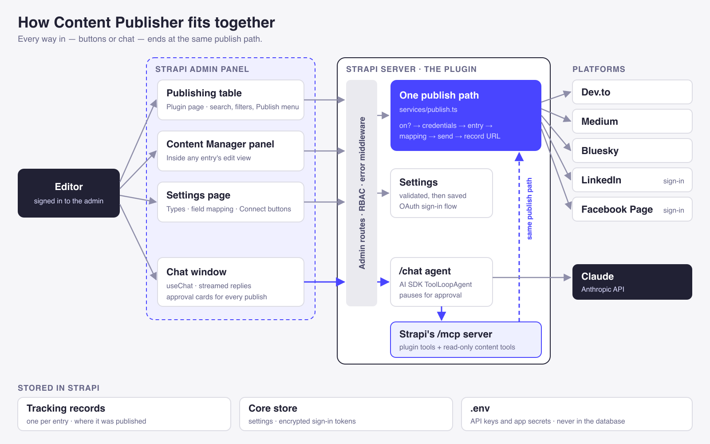
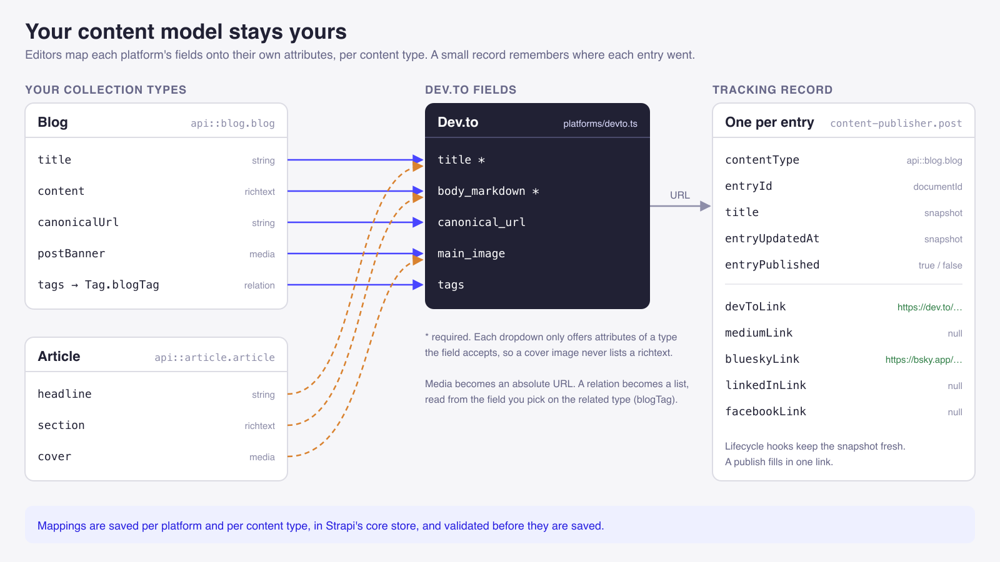
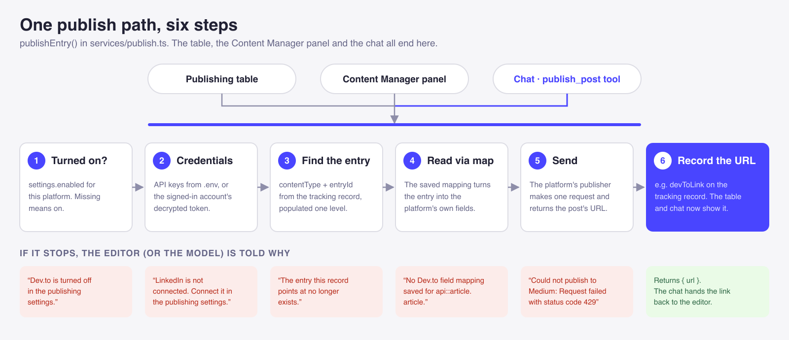

Most plugin tutorials stop at "Hello world" in the admin panel. A real plugin has to answer harder questions:

- Where does it store its own data, and how does that data stay in step with entries it doesn't own?
- Where do settings go?
- How do routes enforce permissions?
- How does a role that can view stop seeing a button it can't use?
- How does an OAuth provider call back into a server that requires a login?

This guide answers each of those with working code from **[Content Publisher](https://github.com/Theodore-Kelechukwu-Onyejiaku/custom-strapi-plugin)**, an open-source Strapi 5 plugin that publishes entries to Dev.to, Medium, Bluesky, LinkedIn and Facebook and records where each one went.

It's Part 2 of two. [Part 1](./blog-post.md) adds MCP tools and an AI assistant to the same plugin, and explains the rule this whole plugin follows: **every caller, from admin pages to MCP tools, goes through the same services.** This part shows the rest of the plugin built around that rule.

**What you'll learn**

- How to give a plugin its own hidden content type and keep it in sync with database lifecycles
- Where to store plugin settings, and how to describe integrations as data
- How to protect admin routes, return readable errors, and secure the one route that can't require a login
- How to apply permissions in the admin UI, and add a panel to the Content Manager's edit view
- How to expose a public read-only API, and what the Strapi Marketplace requires before you publish

Paths are relative to `src/plugins/content-publisher/`, and code samples are trimmed to show one idea at a time.



## Plugin Architecture

| Piece | Purpose | Where in the repo |
| --- | --- | --- |
| A hidden `post` content type | One tracking record per entry, holding each platform's URL | `server/src/content-types/` |
| Lifecycle subscriptions | Keep tracking records in step with entries | `server/src/register.ts` |
| A settings store | Selected types, field mappings, which platforms are on | `server/src/services/settings-store.ts` |
| Platform definitions | Each platform's API fields and credentials, as data | `server/src/platforms/` |
| Services | The only code that reads, publishes and deletes | `server/src/services/` |
| Admin routes and pages | The publishing table, the settings page and an edit view panel | `server/src/routes/`, `admin/src/` |
| A public API | Read-only links for a frontend | `server/src/routes/content-api.ts` |

## Storing Plugin Data

### Defining a Hidden Content Type

Content Publisher needs to remember where each entry was published. Rather than adding fields to the project's own content types, the plugin owns one collection type, with a **tracking record** per entry. A plugin declares a content type with a schema, the same way an app does:

```ts
// server/src/content-types/post.ts (trimmed)
const schema = {
  kind: 'collectionType',
  collectionName: 'posts',
  info: { singularName: 'post', pluralName: 'posts', displayName: 'Post' },
  options: { draftAndPublish: false },

  // internal to the plugin: editors see these records in the publishing table instead
  pluginOptions: {
    'content-manager': { visible: false },
    'content-type-builder': { visible: false },
  },

  attributes: {
    contentType: { type: 'string' },  // the tracked entry's uid, e.g. "api::blog.blog"
    entryId: { type: 'string' },      // its documentId
    title: { type: 'string' },        // a copy, so the table can search in one query
    entryPublished: { type: 'boolean', default: false },
    devToLink: { type: 'text' },      // one URL field per platform
    mediumLink: { type: 'text' },
    blueskyLink: { type: 'text' },
    // … linkedInLink, facebookLink
  },
};

export default { schema };
```

```ts
// server/src/content-types/index.ts
// the key becomes the uid: plugin::content-publisher.post
export default { post };
```

`pluginOptions` hides the type from the Content Manager's sidebar and stops anyone editing its fields in the Content-Type Builder. The data is still there for the plugin's own services and pages.

### Keeping Records in Sync with Database Lifecycles

Each tracking record has to follow its entry: created with it, updated when it's edited or published, removed when it's deleted. The plugin subscribes to database lifecycles in the server `register()`:

```ts
// server/src/register.ts (trimmed)
// no `models` filter: which types are tracked is a setting, checked on every event
const isTracked = async (uid) => {
  if (uid === POST_UID) return false; // our own writes would otherwise trigger this again
  const { contentTypes } = await getSettings(strapi);
  return contentTypes.includes(uid);
};

const sync = async (event) => {
  const uid = event.model?.uid;
  if (await isTracked(uid)) await onEntryChanged(strapi, uid, event.result);
};

strapi.db.lifecycles.subscribe({
  afterCreate: sync,
  afterUpdate: sync,
  // unpublishing deletes the published row, so check the document still exists
  async afterDelete(event) {
    const uid = event.model.uid;
    if (uid === POST_UID) return;
    const documentId = event.result?.documentId;
    const stillThere = await strapi.documents(uid).findOne({ documentId });
    if (stillThere) await onEntryChanged(strapi, uid, stillThere);
    else await onEntryRemoved(strapi, uid, documentId);
  },
});
```

Three Strapi 5 details are behind this code:

- **There's no `models` filter.** An admin can change which types are tracked at any time, so a fixed list would go stale.
- **The plugin's own type is skipped.** Writing a tracking record fires `afterCreate` too, and without the check it would loop.
- **An `afterDelete` isn't always a deletion.** With Draft & Publish, unpublishing deletes the published row while the draft stays. The handler looks the document up again before removing anything.

Lifecycles only see changes made after a type is selected. `syncTrackingRecords()` in `services/backfill.ts` fills the gap. It creates records for entries that already exist and removes records whose entry is gone. It runs in `bootstrap()` and again whenever an admin changes the selection, and running it twice changes nothing.

### Storing Settings in the Core Store

The selected types, field mappings and which platforms are on are configuration, not content, so they don't belong in a content type. Strapi's **core store** is a key-value store for this, the same one the Upload and i18n plugins use:

```ts
// server/src/services/settings-store.ts (trimmed)
const store = (strapi) =>
  strapi.store({ type: 'plugin', name: 'content-publisher', key: 'settings' });

export const getSettings = async (strapi) => ({
  ...EMPTY_SETTINGS, // defaults, so callers never see null
  ...((await store(strapi).get({})) ?? {}),
});

// merges a patch, so saving one part never overwrites another
export const saveSettings = async (strapi, patch) => {
  const next = { ...(await getSettings(strapi)), ...patch };
  await store(strapi).set({ value: next });
  return next;
};
```

`EMPTY_SETTINGS` is `{ contentTypes: [], platforms: {}, enabled: {}, connections: {} }`. Only this file touches the store. Everything else calls `getSettings()`.

## Describing Integrations as Data



The plugin has one publish route and one publish service for five platforms, because each platform is described once, as data:

```ts
// server/src/platforms/devto.ts (trimmed)
const devTo: Platform = {
  key: 'devTo',
  label: 'Dev.to',
  envVars: ['DEVTO_API_KEY'], // read from .env; the settings page only says "Set" or "Missing"
  fields: [
    // key: the field in Dev.to's API; accepts: which Strapi types can be mapped to it
    { key: 'title', label: 'Title', required: true, accepts: ['string', 'text'] },
    { key: 'body_markdown', label: 'Content', required: true, accepts: ['text', 'richtext'] },
    { key: 'main_image', label: 'Cover image', required: false, accepts: ['media'] },
  ],
};
```

```ts
// server/src/platforms/index.ts
export const PLATFORMS: Platform[] = [devTo, medium, bluesky, linkedIn, facebook];
```

Much of the plugin is built from this list:

- the settings page's mapping dropdowns, filtered by `accepts`;
- the `:platform` parameter of the publish route;
- the `z.enum` of the MCP publish tool from Part 1.

An admin maps each platform field to an attribute of their own content type, such as `body_markdown` → `content`. The publish service reads the entry through that mapping, so the plugin never hard-codes a project's attribute names. Adding a platform means writing a definition and one function that sends the request. The routes, the MCP tool and the settings page don't change.

## Protecting Admin Routes



### Writing Thin Controllers

```ts
// server/src/controllers/controller.ts (trimmed)
const service = (strapi) => strapi.plugin('content-publisher').service('service');

const controller = ({ strapi }) => ({
  async getPosts(ctx) {
    ctx.body = await service(strapi).getPosts(ctx.query);
  },

  async publish(ctx) {
    const { id, platform } = ctx.params;
    ctx.body = await service(strapi).publish(platform, id);
  },

  async deletePost(ctx) {
    ctx.body = await service(strapi).deletePost({ postId: ctx.params.id });
  },
});

export default controller;
```

Each method reads the request and calls a service. None of them queries the database or repeats a rule.

### Applying Permission Policies to Every Route

An admin route should check that someone is logged in to the admin **and** that their role has the right permission. Strapi provides a policy for each, and a small helper applies both every time:

```ts
// server/src/routes/can.ts
export const middlewares = ['plugin::content-publisher.plugin-errors'];

// hasPermissions requires *every* action listed, so can(READ, PUBLISH) means both
export const can = (...actions: string[]) => ({
  policies: [
    'admin::isAuthenticatedAdmin',
    { name: 'admin::hasPermissions', config: { actions } },
  ],
  middlewares,
});
```

```ts
// server/src/routes/posts.ts
import { DELETE, PUBLISH, READ } from '../permissions';
import { can } from './can';

export default [
  { method: 'GET', path: '/posts', handler: 'controller.getPosts', config: can(READ) },
  {
    // one route for every platform: /posts/:id/publish/devTo, …/publish/medium, …
    method: 'POST',
    path: '/posts/:id/publish/:platform',
    handler: 'controller.publish',
    config: can(READ, PUBLISH),
  },
  {
    method: 'DELETE',
    path: '/posts/:id',
    handler: 'controller.deletePost',
    config: can(READ, DELETE),
  },
];
```

```ts
// server/src/routes/index.ts
export default {
  admin: { type: 'admin', routes: admin },                    // /content-publisher/…
  'content-api': { type: 'content-api', routes: contentApi }, // /api/content-publisher/…
};
```

The paths are RESTful: the HTTP method says what happens, and ids are in the path. A single `/posts/:id/publish/:platform` route replaced five `/publish-to-<platform>` routes.

Admin routes never need `auth: false`, because admin pages send the admin's JWT. An audit of Content Publisher found its post routes, publish and delete included, still set to `auth: false` from an early prototype, so anyone who could reach the server could use them. Search your plugin for `auth: false` before you release it.

### Splitting Settings Routes by Permission

The settings page has its own routes. Reading needs `SETTINGS_READ`, and every change needs `SETTINGS_UPDATE`:

| Route | Permission | Purpose |
| --- | --- | --- |
| `GET /settings` | `SETTINGS_READ` | Selected types, mappings, and whether each env var is set |
| `GET /publish-targets` | `READ` | Publishable types and whether each platform is on |
| `PUT /settings/content-types` | `SETTINGS_UPDATE` | Choose the publishable types, then run the backfill |
| `PUT /settings/platforms/:platform` | `SETTINGS_UPDATE` | Save one platform's field mapping |
| `PUT /settings/platforms/:platform/enabled` | `SETTINGS_UPDATE` | Turn a platform on or off |
| `POST /settings/platforms/:platform/test` | `SETTINGS_UPDATE` | Check credentials without publishing |

`/publish-targets` needs only `READ` on purpose: editors need to know which platforms are on, not how they're configured. `GET /settings` returns `{ configured: true }` for each env var and never the value, so not even an admin can read an API key from the browser.

### Returning Readable Errors with a Plugin Middleware

`can()` also attaches the plugin's `plugin-errors` middleware. Strapi's error handler recognizes its error classes with `instanceof`, but a plugin can end up with its own copy of `@strapi/utils`. Its classes are then different objects, the check fails, and a message like "is a draft. Publish it in Strapi first." reaches the browser as a bare 500. The middleware matches on `error.name` instead:

```ts
// server/src/middlewares/plugin-errors.ts (trimmed)
const STATUS_BY_NAME = { NotFoundError: 404, ForbiddenError: 403 /* … */ };
const KNOWN = new Set(['ApplicationError', 'ValidationError', ...Object.keys(STATUS_BY_NAME)]);

export default (_config, { strapi }) => async (ctx, next) => {
  try {
    await next();
  } catch (error) {
    const known = KNOWN.has(error?.name);
    const status = known ? (STATUS_BY_NAME[error.name] ?? 400) : 500;
    if (!known) strapi.log.error(error); // a real bug: logged, not shown

    ctx.status = status;
    ctx.body = {
      data: null,
      error: {
        status,
        name: known ? error.name : 'InternalServerError',
        message: known ? error.message : 'Internal Server Error',
      },
    };
  }
};
```

```ts
// server/src/middlewares/index.ts
// referenced in routes as 'plugin::content-publisher.plugin-errors'
export default { 'plugin-errors': pluginErrors };
```

The response keeps Strapi's own error shape, so admin pages read the message the same way they would for a core error.

## Securing an OAuth Callback Route

LinkedIn and Facebook use OAuth. The admin clicks **Connect**, signs in to the provider in a popup, and the provider redirects back with a code. The provider sends that request, not the admin panel, so it carries no admin token. The callback is the plugin's one route with `auth: false`:

```ts
// server/src/routes/connections.ts (trimmed)
{
  method: 'POST',
  path: '/settings/platforms/:platform/connect',
  handler: 'connection.start',
  config: can(SETTINGS_UPDATE),
},
{
  // called by LinkedIn or Facebook: guarded by the one-time state below
  method: 'GET',
  path: '/connect/:platform/callback',
  handler: 'connection.callback',
  config: { auth: false, policies: [], middlewares },
},
```

Without a login check, the OAuth `state` value proves the request was started from this admin panel:

```ts
// server/src/services/oauth/state.ts (trimmed)
const TEN_MINUTES = 10 * 60 * 1000;

export const createState = async (strapi, platform, redirectUri) => {
  const state = crypto.randomBytes(24).toString('hex');
  const all = fresh(await load(strapi)); // load() reads the core store; fresh() drops expired
  all[state] = { platform, redirectUri, expiresAt: Date.now() + TEN_MINUTES };
  await store(strapi).set({ value: all });
  return state;
};

// returns the pending sign-in and deletes it, so a state can't be used twice
export const consumeState = async (strapi, state, platform) => {
  const all = fresh(await load(strapi));
  const pending = all[state];
  delete all[state];
  await store(strapi).set({ value: all });
  return pending?.platform === platform ? pending : null;
};
```

Only an admin with `SETTINGS_UPDATE` can call `start`, and `start` is what creates a state. The callback rejects a state it didn't issue, one older than ten minutes, or one already used. The access token it receives is encrypted with Strapi's `admin::encryption` service before it's stored, and the plugin refuses to store it at all without an `ENCRYPTION_KEY`.

## Applying Permissions in the Admin UI

The server enforces every permission. The admin UI checks the same permissions so it doesn't show links, pages or buttons a user can't use.

### Declaring Permissions in the Admin Code

```ts
// admin/src/permissions.ts
const pluginPermissions = {
  read: [{ action: 'plugin::content-publisher.read', subject: null }],
  publish: [{ action: 'plugin::content-publisher.publish', subject: null }],
  delete: [{ action: 'plugin::content-publisher.delete', subject: null }],
  settingsRead: [{ action: 'plugin::content-publisher.settings-read', subject: null }],
};

export default pluginPermissions;
```

### Protecting the Menu Link and Pages

```tsx
// admin/src/index.tsx (trimmed)
register(app) {
  app.addMenuLink({
    to: `plugins/${PLUGIN_ID}`,
    icon: PluginIcon,
    intlLabel: { id: `${PLUGIN_ID}.plugin.name`, defaultMessage: 'Content Publisher' },
    Component: async () => (await import('./pages/App')).App,
    permissions: pluginPermissions.read, // the link only shows for roles with "read"
  });
},
```

```tsx
// admin/src/pages/App.tsx (trimmed)
<Routes>
  <Route index element={
    <Page.Protect permissions={pluginPermissions.read}><HomePage /></Page.Protect>
  } />
  <Route path="settings" element={
    <Page.Protect permissions={pluginPermissions.settingsRead}><SettingsPage /></Page.Protect>
  } />
</Routes>
```

A user who opens either URL directly without permission sees Strapi's "no permission" page.

### Showing Only the Actions a Role Can Use

`useRBAC` from `@strapi/strapi/admin` reports which of the given permissions the logged-in admin holds:

```ts
// admin/src/hooks/usePostPermissions.ts
import { useRBAC } from '@strapi/strapi/admin';
import pluginPermissions from '../permissions';

const CHECKS = { publish: pluginPermissions.publish, delete: pluginPermissions.delete };

export const usePostPermissions = () => {
  // results are named after the last part of each uid: publish -> canPublish
  const { allowedActions, isLoading } = useRBAC(CHECKS);

  // false while loading, so a button never appears and then disappears
  return {
    canPublish: !isLoading && Boolean(allowedActions.canPublish),
    canDelete: !isLoading && Boolean(allowedActions.canDelete),
  };
};
```

The publishing table checks once and passes the answers down, leaving out what the role can't use:

```tsx
// admin/src/components/PublishingTable.tsx (trimmed)
const { canPublish, canDelete } = usePostPermissions();
<PostCells post={post} canPublish={canPublish} onDelete={canDelete ? remove : undefined} />

// admin/src/components/table/PostCells.tsx (trimmed)
{canPublish ? <PublishMenu post={post} platforms={platforms} onPublish={publishTo} /> : null}
{onDelete ? <DeleteDialog onConfirm={() => onDelete(post.documentId)} /> : null}
```

Requests go through `useFetchClient`, which sends the admin's JWT that the `can(...)` policies check:

```ts
// admin/src/hooks/usePublishRow.ts (trimmed)
const { post: postRequest } = useFetchClient();

try {
  // publishPath() builds /content-publisher/posts/:id/publish/:platform
  await postRequest(publishPath(target, post.documentId));
  toggleNotification({ type: 'success', message: `Published to ${target.label}.` });
} catch (err) {
  // the service's message, passed through by plugin-errors
  toggleNotification({ type: 'danger', message: err?.response?.data?.error?.message });
}
```

A role with only "Access the publishing table" sees the table without the Publish menu or the Delete button. If someone calls a route directly anyway, `can(READ, PUBLISH)` rejects it.


### Adding a Panel to the Content Manager with an Injection Zone

Content Publisher adds a **Publish to** panel to the Content Manager's edit view, so editors can publish without leaving an entry. It uses an **injection zone**, a named place in another plugin's UI where your plugin can render a component. The panel goes in `editView` → `right-links`, the edit view's sidebar:


```tsx
// admin/src/index.tsx (trimmed)
// bootstrap(), not register(): the Content Manager isn't ready until every plugin registers
async bootstrap(app) {
  app.getPlugin('content-manager').injectComponent('editView', 'right-links', {
    name: 'content-publisher',
    Component: EntryPublishPanel,
  });
},
```

The component renders on every content type's edit view. It reads which entry is open and renders nothing for types that aren't publishable:

```tsx
// admin/src/components/EntryPublishPanel.tsx (trimmed)
const { slug, id } = unstable_useContentManagerContext(); // the open entry's type and id
const { contentTypes, platforms } = usePublishTargets();  // GET /publish-targets
const enabled = Boolean(contentTypes?.includes(slug));

// the same route, hooks and permission check as the publishing table
const { post, reload } = useEntryPost({ contentType: slug, entryId: id, enabled });
const { publishTo, busy } = usePublishRow(post, reload);
const { canPublish } = usePostPermissions();

if (!enabled) return null; // after the hooks, as React requires
```

The panel has no logic of its own, so the draft rule, the duplicate rule and the publish permission apply here too. For the other zones, and for the typed Content Manager APIs such as `addEditViewSidePanel` that Strapi recommends when one fits, see [Injection zones](https://docs.strapi.io/cms/plugins-development/admin-injection-zones).

## Exposing a Public API with Content API Routes

A frontend may want to show "Also on Dev.to and Medium" under a blog post. Plugins declare **content-api routes** for this. They're served under `/api/content-publisher/` and controlled by Users & Permissions instead of admin permissions:

```ts
// server/src/routes/content-api.ts
// no auth: false and no admin policies: Users & Permissions decides who can call these
const config = { policies: [], middlewares };

export default [
  { method: 'GET', path: '/posts', handler: 'posts.find', config },
  { method: 'GET', path: '/posts/by-entry', handler: 'posts.findByEntry', config },
];
```

The `posts` controller calls the same `getPosts` and trims each post to its public fields:

```ts
// server/src/controllers/posts.ts (trimmed)
async find(ctx) {
  const { posts, pagination } = await service(strapi).getPosts(ctx.query);
  // title, content type, entry id and each platform's URL; nothing internal
  ctx.body = { data: posts.map(toPublicPost), meta: { pagination } };
},
```

The plugin doesn't register these permissions. At startup, Users & Permissions reads every content-api route and turns each `handler` into a permission, so `posts.find` appears as **Posts → find**:

1. Go to *Settings → Users & Permissions plugin → Roles*.
2. Open **Public**, or **Authenticated** for logged-in site users.
3. Expand **Content-publisher → Posts** and tick **find** and **findByEntry**.


The same checkboxes appear on an API token with **Custom** permissions, which keeps the routes private to a frontend's server. Until they're ticked, the routes return 403.

| | Admin routes | Content-api routes |
| --- | --- | --- |
| Called by | The plugin's admin pages, with the admin's JWT | Frontends and scripts, with API tokens or no auth |
| Access granted in | Admin roles and tokens, using the plugin's own permissions | Users & Permissions and API tokens |
| Permissions created by | The plugin, with `registerMany` | Strapi, from each route's `handler` |

Content Publisher makes public only data that's already public (titles and platform URLs). Publishing, deleting, settings and sign-in stay admin-only.

## Strapi 5 Behaviors That Affect Plugins

- **A local plugin runs from its `dist` folder.** Run `npm run build` in the plugin, or keep `npm run watch` running. Otherwise new routes return 404 and new permissions don't appear.
- **The Document Service returns drafts by default.** A plugin that sends content elsewhere must read with `status: 'published'`. Content Publisher's first version sent unpublished edits to Dev.to.
- **Lifecycles fire on the draft row.** Editing a published entry triggers `afterUpdate` with the draft, whose `publishedAt` is `null`. Look up the published version instead of trusting the row.
- **Local uploads have relative URLs.** `/uploads/banner.jpg` becomes `http://localhost:1337/uploads/banner.jpg`, which other platforms' servers can't fetch. Use an upload provider with public URLs.

## Publishing to npm and the Strapi Marketplace

Check the package the way the Marketplace will:

```bash
cd src/plugins/content-publisher
npm run verify          # @strapi/sdk-plugin checks package.json and the exports
npm test                # unit tests
npm audit --omit=dev    # what ships to users should report 0 vulnerabilities
npm run build && npm publish
```

The [Marketplace guidelines](https://community.strapi.io/help/market-guidelines) also require:

- **A public npm package** under the MIT license, with `@strapi/strapi` as a peer dependency
- **A new major version for Strapi 5**, separate from any v4 build. Breaking changes such as new permissions call for a major bump too.
- **Design System v2** for every admin screen
- **A PNG or JPG logo** of about 160×160 pixels, and a 50–150 character description
- **A README** covering prerequisites, installation, configuration and how to report issues
- **No paywalled features.** Anything that needs a paid service, like Content Publisher's optional AI chat, must be optional.
- **No unprotected sensitive endpoints**

Validate your plugin config too. Content Publisher's `server/src/config/index.ts` exports a `validator` that rejects unknown keys, so a typo in `config/plugins.ts` stops Strapi with a clear error instead of being ignored.

## Security Checklist

| Practice | How Content Publisher does it |
| --- | --- |
| No admin route left open | Every route uses `can(...)`; only the OAuth callback has `auth: false`, guarded by a one-time `state` |
| Separate permissions for each power | Viewing, publishing, deleting and settings are separate |
| The UI and the server agree | The admin hides what a role can't use; `can(...)` still rejects direct calls |
| Secrets out of the database | API keys live in `.env`; the settings page shows only "Set" or "Missing" |
| Encrypted runtime tokens | OAuth tokens go through `admin::encryption`, and are refused without an `ENCRYPTION_KEY` |
| Nothing internal in public | Content-api routes return titles and links only |

## Troubleshooting

| Symptom | Likely cause | Fix |
| --- | --- | --- |
| New routes return 404 | The plugin's `dist` is stale | Run `npm run build` or keep `npm run watch` running |
| A role sees a button but gets 403 | The UI doesn't check the permission the route requires | Check the same permission with `useRBAC` |
| A route returns a bare 500 with no message | Strapi doesn't recognize the plugin's error classes | Add a middleware that maps errors by `error.name` |
| Tracking records are missing for old entries | Lifecycles only see new changes | Backfill on `bootstrap()` and when the selection changes |
| The edit view panel never appears | Injected in the admin `register()`, or the type isn't selected | Inject in `bootstrap()`, and select the type in settings |
| A content-api route returns 403 | It hasn't been granted | Tick it under *Users & Permissions → Roles* or on an API token |
| A published post has no cover image | The image URL points at `localhost` | Use an upload provider with public URLs |

## Conclusion

A production Strapi plugin needs more than the feature itself:

- data it owns and keeps in step with entries it doesn't;
- settings in the core store;
- integrations described as data;
- routes that check permissions;
- errors that reach the user;
- an admin UI that matches what the server allows.

None of these takes much code. Each one comes from a problem that Content Publisher hit while it was being built.

[Part 1](./blog-post.md) adds MCP tools and an AI assistant on top of this foundation. That's safe precisely because the services, permissions and routes described here already exist.

- **Repository:** [github.com/Theodore-Kelechukwu-Onyejiaku/custom-strapi-plugin](https://github.com/Theodore-Kelechukwu-Onyejiaku/custom-strapi-plugin)
- **Design decisions:** `src/plugins/content-publisher/logic.md`
