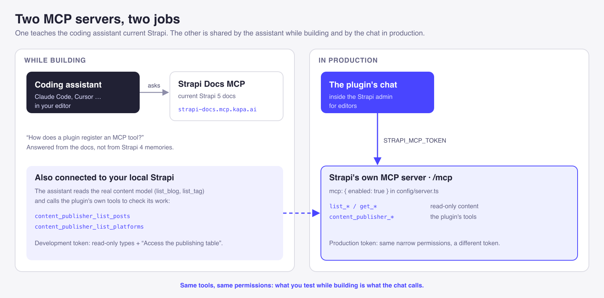
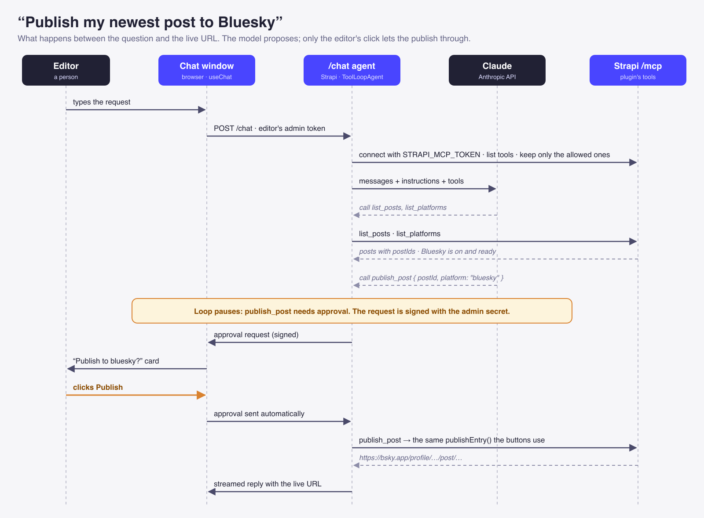

Turn on Strapi 5's built-in MCP server and an AI client like Claude Code or Cursor can immediately list, create, update and publish your content. Those tools are generated from your content types, so they only know about fields. They don't know your rules.

Content Publisher is an open-source plugin that publishes Strapi entries to Dev.to, Medium, Bluesky, LinkedIn and Facebook. Publishing has rules: drafts can't go out, a post can't be published to the same platform twice, and a platform has to be connected first. An AI client working only with `update_blog` would know none of that. Give the plugin its own MCP tools that call its own logic, and the AI follows the same rules as the Publish button, with the same permissions.

That's the main idea of this guide: **an MCP tool should be another way to call your plugin's logic, never a second copy of it.** Do it that way and the AI can't do anything the admin UI can't.

**What you'll learn**

- Why a plugin's MCP tools should call its services instead of the database
- How to register a permission for each tool, and where those permissions appear in the admin panel
- How to define tools with `ai.mcp.defineTool`, and when to register them
- How to connect an MCP client with an admin token and check which tools it can see
- How to build an AI assistant into the admin panel that follows the editor's permissions and asks before it publishes


The full source is on [GitHub](https://github.com/Theodore-Kelechukwu-Onyejiaku/custom-strapi-plugin). Paths below are relative to `src/plugins/content-publisher/`, and each step links to the complete files. Code samples are trimmed to show one idea at a time.

This is Part 1 of two. [Part 2](./blog-post-production-plugin.md) covers the rest of the plugin: its content type and lifecycles, settings storage, error handling, OAuth, permissions in the admin UI, an injection zone, a public API and publishing to the Marketplace.

## How Content Publisher Uses the Strapi MCP Server



The plugin adds three tools to Strapi's MCP server:

| Tool | What it does | Permission |
| --- | --- | --- |
| `content_publisher_list_posts` | Lists published entries, where each one is already published, and their ids | List posts |
| `content_publisher_list_platforms` | Says which platforms are on and have credentials | List platforms |
| `content_publisher_publish_post` | Publishes one post to one platform | Publish a post |

Any MCP client can use them. The plugin's own admin chat uses them too.

A few facts about the MCP server shape what follows:

1. **It's served at `/mcp`** on your Strapi instance, over streamable HTTP.
2. **It only accepts admin tokens**, created under *Settings → Administration Panel → Admin Tokens*. Other tokens get a 401.
3. **It generates CRUD tools for your content types**, such as `list_blog`, `get_blog` and `update_blog`. Plugin tools sit alongside them.
4. **A token sees only the tools it has permission to use.** A tool it can't use isn't refused with an error; it's missing from the tool list.
5. **Tools must be registered before the server starts.** Step 5 covers exactly when that is.

## Prerequisites

- **Strapi 5 with the built-in MCP server.** Content Publisher is built and tested on 5.60 and supports `^5.54.0`.
- **Node.js 20 or 22**
- **A local plugin.** To create one, run `npx @strapi/sdk-plugin init my-plugin`, enable it in `config/plugins.ts`, and keep `npm run watch` running in the plugin folder so Strapi loads your changes.
- **An MCP client** such as Claude Code, Cursor or Claude Desktop
- **For Step 7 only:** an Anthropic API key

## Step 1: Enable the Strapi MCP Server

The MCP server is off by default. Turn it on in the project's server config:

```ts
// config/server.ts
export default ({ env }) => ({
  host: env('HOST', '0.0.0.0'),
  port: env.int('PORT', 1337),
  app: { keys: env.array('APP_KEYS') },
  mcp: { enabled: env.bool('MCP_ENABLED', true) },
});
```

Reading `MCP_ENABLED` from the environment lets you switch the server off where it isn't needed.

**Check it.** Restart Strapi and send a request with no token:

```bash
curl -i -X POST http://localhost:1337/mcp
```

A `401` means the server is running and rejected the anonymous request. A `404` means it isn't enabled.

## Step 2: Put the Plugin's Logic in a Service

Write the service before any tool. Content Publisher publishes from four places: the publishing table, a panel in the Content Manager, the MCP tools and the chat. If each one had its own database code, each would have its own copy of the rules, and sooner or later they'd disagree. So every job is one method on one service, and **every caller calls that method**:

```ts
// server/src/services/service.ts (trimmed)
const service = ({ strapi }) => ({
  // used by the publishing table, the MCP list tool and the public API
  async getPosts(query) {
    return queries.getPosts(strapi, query);
  },

  // one method for every platform: devTo, medium, bluesky, linkedIn or facebook
  async publish(platformKey: string, postId: string) {
    return publishPost(strapi, platformKey, postId);
  },
});

export default service;
```

```ts
// server/src/services/index.ts
export default { service, setting, connection };
```

Strapi registers each key, so any code can call `strapi.plugin('content-publisher').service('service')`. The rules live inside the method:

```ts
// server/src/services/publish-post.ts (simplified)
import { errors } from '@strapi/utils';

const { ApplicationError, NotFoundError } = errors;
const POST_UID = 'plugin::content-publisher.post';

export const publishPost = async (strapi, platformKey, postId) => {
  // loaded by id on the server, never taken from the request
  const post = await strapi.documents(POST_UID).findOne({ documentId: postId });
  if (!post) throw new NotFoundError(`No post with id ${postId}.`);

  if (!post.entryPublished) {
    throw new ApplicationError(`"${post.title}" is a draft. Publish it in Strapi first.`);
  }
  if (post[`${platformKey}Link`]) {
    throw new ApplicationError(`"${post.title}" is already on that platform.`);
  }

  // check the platform is on, load its credentials, send the entry, save the returned URL
  const url = await sendToPlatform(strapi, post, platformKey);
  return { url, title: post.title };
};
```

Three details make this safe to expose to an AI:

- **It takes an id, not a record.** It loads the post itself, so a caller can't send a doctored post.
- **The rules are in one place.** The draft check and the duplicate check apply to every caller.
- **Its errors say what to fix.** `ApplicationError` and `NotFoundError` from `@strapi/utils` carry a readable message. Step 5 passes that message to the AI model, so it can tell the editor why a publish failed.

The structure proved itself. After the tools and chat were added, an audit found that publishing sent draft content and trusted the post sent in the request body. Each bug was fixed once, in this service, and every caller got the fix.

Full files: [`services/service.ts`](https://github.com/Theodore-Kelechukwu-Onyejiaku/custom-strapi-plugin/blob/main/src/plugins/content-publisher/server/src/services/service.ts), [`services/publish-post.ts`](https://github.com/Theodore-Kelechukwu-Onyejiaku/custom-strapi-plugin/blob/main/src/plugins/content-publisher/server/src/services/publish-post.ts). Part 2 covers the `post` content type the service reads and how it stays in sync.

## Step 3: Register a Permission for Each Tool

The MCP server decides whether a token can see a tool by checking a permission, but **a permission only exists in the admin panel if your plugin registers it.** Give each tool its own:

```ts
// server/src/permissions.ts (trimmed)
const action = (uid: string, displayName: string, subCategory?: string) => ({
  section: 'plugins',
  pluginName: 'content-publisher',
  uid,
  displayName,
  ...(subCategory ? { subCategory } : {}),
});

export const ACTIONS = [
  action('read', 'Access the publishing table'),
  action('publish', 'Publish posts to platforms'),
  // … delete and the two settings permissions

  // one per MCP tool, so each can be granted on its own
  action('tool.list-posts', 'List posts', 'AI tools'),
  action('tool.list-platforms', 'List platforms', 'AI tools'),
  action('tool.publish-post', 'Publish a post', 'AI tools'),
];

// Strapi names each action plugin::<pluginName>.<uid>
const id = (uid: string) => `plugin::content-publisher.${uid}`;

export const PUBLISH = id('publish');
export const TOOL_LIST_POSTS = id('tool.list-posts');
export const TOOL_LIST_PLATFORMS = id('tool.list-platforms');
export const TOOL_PUBLISH_POST = id('tool.publish-post');
```

Each property decides where the checkbox appears. `section: 'plugins'` puts it on the **Plugins** tab, `pluginName` groups it under the plugin, `subCategory` adds the "AI tools" heading, and `displayName` is the checkbox label.

Register the actions in the server `bootstrap()`:

```ts
// server/src/bootstrap.ts (trimmed)
import { ACTIONS } from './permissions';

const bootstrap = async ({ strapi }) => {
  await strapi.service('admin::permission').actionProvider.registerMany(ACTIONS);
};

export default bootstrap;
```

**Check it.** Restart Strapi and go to *Settings → Administration Panel → Admin Tokens*. Create or edit a token, open the **Plugins** tab, and expand **Content Publisher**. The general permissions come first, then the **AI tools** heading with "List posts", "List platforms" and "Publish a post".


The same checkboxes appear on roles, under *Settings → Roles → (a role) → Plugins*. A role and a token are separate grants: ticking a box on one doesn't tick it on the other.

Four rules for permission `uid`s:

- **Only lowercase letters, dots and dashes.** One `uid` with an underscore makes the whole `registerMany` call fail, so *no* checkboxes appear. That's why it's `tool.publish-post`, not `tool.publish_post`.
- **Prefer dashes to extra dots.** The admin's `useRBAC` hook names its results after the last dot-segment, so `settings.read` and `read` would both become `canRead`.
- **One action per tool.** Reusing a Content Manager permission ties your tool to a content type.
- **Renaming a `uid` is a breaking change.** Strapi drops grants for actions that no longer exist, so every token loses the tool until the new box is ticked.

Full file: [`permissions.ts`](https://github.com/Theodore-Kelechukwu-Onyejiaku/custom-strapi-plugin/blob/main/src/plugins/content-publisher/server/src/permissions.ts).

## Step 4: Define the Tools with `ai.mcp.defineTool`

Each tool goes in its own file. `ai.mcp.defineTool` from `@strapi/strapi` returns the definition unchanged and only adds type inference. The schemas use `z`, the Zod instance Strapi re-exports from `@strapi/utils`. The helpers `authFor`, `pluginService`, `ok`, `failed` and `PLATFORM_KEYS` come from `mcp/shared.ts`, shown in Step 5.

### Creating a Write Tool

```ts
// server/src/mcp/publish-post.ts
import { ai } from '@strapi/strapi';
import { z } from '@strapi/utils';

import { TOOL_PUBLISH_POST } from '../permissions';
import { PLATFORM_KEYS, authFor, failed, ok, pluginService } from './shared';

export default ai.mcp.defineTool({
  name: 'content_publisher_publish_post',
  title: 'Publish a post to a platform',
  description:
    'Publishes one post (by postId from content_publisher_list_posts) to one platform. ' +
    'This is public and cannot be undone, so only call it when the editor has asked ' +
    'for that exact post and platform.',
  auth: authFor(TOOL_PUBLISH_POST),
  resolveInputSchema: () =>
    z.object({
      postId: z.string().describe('postId from content_publisher_list_posts'),
      platform: z.enum(PLATFORM_KEYS).describe('Platform key'),
    }),
  resolveOutputSchema: () => z.object({ platform: z.string(), url: z.string() }),
  createHandler: (strapi) => async ({ args }) => {
    try {
      const service = pluginService(strapi, 'service');
      const { url, title } = await service.publish(args.platform, args.postId);
      return ok(`Published "${title}" to ${args.platform}: ${url}`, {
        platform: args.platform,
        url: String(url),
      });
    } catch (error) {
      // the service's message says what to fix: "is a draft", "turned off" …
      return failed(error?.message ?? `Could not publish to ${args.platform}.`);
    }
  },
});
```

What each option does:

- **`name`** is what the model calls. Prefix it with your plugin's name, because every plugin shares one tool list.
- **`description`** is the model's only guide to when to call the tool. This one says where `postId` comes from and that publishing "cannot be undone", which stops the model publishing unprompted.
- **`auth`** links the tool to its permission from Step 3. This is what makes the "Publish a post" checkbox control the tool.
- **`resolveInputSchema`** validates arguments before the handler runs. `z.enum(PLATFORM_KEYS)` allows only the five supported platforms, and each `.describe()` tells the model what to send.
- **`resolveOutputSchema`** describes the data returned in `structuredContent`.
- **`createHandler`** receives `strapi` once and returns the function that runs on each call. It calls the service from Step 2 and nothing else.

### Creating Read-Only Tools

The two list tools follow the same shape. `content_publisher_list_posts` passes its arguments to the same `getPosts` the publishing table uses, so search behaves the same in both:

```ts
// server/src/mcp/list-posts.ts (handler)
createHandler: (strapi) => async ({ args }) => {
  // the table's own query params: _q is its search box, pageSize its page length
  const { posts } = await pluginService(strapi, 'service').getPosts({
    _q: args.search,
    pageSize: args.limit ?? 20,
  });

  // the post's id plus its public fields: title, entry id and each platform's URL
  const rows = posts.map((post) => ({ postId: post.documentId, ...toPublicPost(post) }));
  return ok(`${rows.length} post(s).`, { posts: rows });
},
```

`content_publisher_list_platforms` takes no input and returns which platforms are on and have credentials. With it, the model can say "LinkedIn isn't connected" instead of attempting a publish that will fail:

```ts
// server/src/mcp/list-platforms.ts (handler)
createHandler: (strapi) => async () => {
  const platforms = await pluginService(strapi, 'setting').platformStatus();
  return ok(`${platforms.length} platform(s).`, { platforms });
},
```

Full files: [`server/src/mcp/`](https://github.com/Theodore-Kelechukwu-Onyejiaku/custom-strapi-plugin/tree/main/src/plugins/content-publisher/server/src/mcp).

## Step 5: Format Tool Results and Register the Tools

### Formatting Results and Errors

The three tools share one file of helpers:

```ts
// server/src/mcp/shared.ts
import { PLATFORMS } from '../platforms';

// A token only sees the tool if it holds this action.
export const authFor = (action: string) => ({
  policies: [{ action }] as [{ action: string }],
});

// The same services the controllers call.
export const pluginService = (strapi, name: 'service' | 'setting') =>
  strapi.plugin('content-publisher').service(name);

// ['devTo', 'medium', 'bluesky', 'linkedIn', 'facebook']
export const PLATFORM_KEYS = PLATFORMS.map((p) => p.key) as [string, ...string[]];

// A short line for people, plus the data as JSON for the model.
export const ok = (text: string, data: Record<string, unknown>) => ({
  content: [{ type: 'text' as const, text: `${text}\n${JSON.stringify(data)}` }],
  structuredContent: data,
});

// The model reads the message and can tell the editor what to fix.
export const failed = (text: string) => ({
  content: [{ type: 'text' as const, text }],
  isError: true as const,
});
```

Two choices here matter:

- **Put the data in the text as well as in `structuredContent`.** Some clients, including the Vercel AI SDK used in Step 7, hand the model only the text. Without the JSON, the model received "11 post(s)." and none of the ids it needed for its next call.
- **Return errors; don't throw them.** `failed(error.message)` reaches the model as a normal result, so it can say "That post is a draft. Publish it in Strapi first." A thrown error gives it nothing to work with.

### Registering the Tools

```ts
// server/src/mcp/index.ts
import listPosts from './list-posts';
import listPlatforms from './list-platforms';
import publishPost from './publish-post';

export const TOOLS = [listPosts, listPlatforms, publishPost];
export const TOOL_NAMES = TOOLS.map((tool) => tool.name);

export const registerMcpTools = (strapi) => {
  const mcp = strapi.ai?.mcp;
  if (!mcp?.isEnabled?.()) return; // MCP is off in config/server.ts

  TOOLS.forEach((tool) => mcp.registerTool(tool));
};
```

```ts
// server/src/register.ts (trimmed)
import { registerMcpTools } from './mcp';

const register = ({ strapi }) => {
  registerMcpTools(strapi);
};

export default register;
```

When to register matters. Strapi runs every plugin's `bootstrap()`, then starts the MCP server, then runs the **app's** `bootstrap()` in `src/index.ts`. So:

- A plugin's `register()` works, and it's the recommended place.
- A plugin's `bootstrap()` also works, if a tool needs something only available then, such as data from the database.
- The app's `bootstrap()` is too late. Registering there throws `[MCP] Cannot register tools after the MCP server has started.`

Permissions are different. Strapi checks a tool's permission on every request, so registering the actions in `bootstrap()` (Step 3) is fine.

## Step 6: Connect an MCP Client and Test Tool Access

### Configuring an Admin Token and a Client

Create an admin token and tick only what the client needs:

- **Content Manager → read** on the publishable content types
- **Content Publisher → AI tools →** "List posts" and "List platforms", plus "Publish a post" if the client may publish

Point the client at Strapi. In a project `.mcp.json`, read the token from the environment so it's never committed:

```json
{
  "mcpServers": {
    "strapi": {
      "type": "http",
      "url": "http://localhost:1337/mcp",
      "headers": { "Authorization": "Bearer ${STRAPI_MCP_TOKEN}" }
    }
  }
}
```

The client discovers the tools from the server; you don't list them in the config. In Claude Code, `/mcp` shows the connected servers, and the three `content_publisher_*` tools appear under `strapi`. Ask "which posts aren't on Dev.to yet?" and it calls `content_publisher_list_posts`.


While you build, also add Strapi's documentation MCP server (`https://strapi-docs.mcp.kapa.ai`). Coding assistants have seen far more Strapi 4 code than Strapi 5 code, and the docs server keeps their answers current.

### Testing Tool Permissions with `tools/list`

Two requests show exactly what a token sees. The first starts a session:

```bash
curl -si http://localhost:1337/mcp \
  -H "Authorization: Bearer $STRAPI_MCP_TOKEN" \
  -H "Content-Type: application/json" \
  -H "Accept: application/json, text/event-stream" \
  -d '{"jsonrpc":"2.0","id":1,"method":"initialize","params":{
       "protocolVersion":"2025-06-18","capabilities":{},
       "clientInfo":{"name":"curl","version":"1"}}}'
```

Copy the `mcp-session-id` response header, then list the tools:

```bash
curl -s http://localhost:1337/mcp \
  -H "Authorization: Bearer $STRAPI_MCP_TOKEN" \
  -H "Mcp-Session-Id: $SESSION_ID" \
  -H "Content-Type: application/json" \
  -H "Accept: application/json, text/event-stream" \
  -d '{"jsonrpc":"2.0","id":2,"method":"tools/list"}'
```

**Check it.** Untick "Publish a post" on the token and list the tools again. `content_publisher_publish_post` should disappear while the two list tools stay. If it doesn't, the tool's `auth` doesn't point at the action you expect.

## Step 7: Build an AI Assistant into the Admin Panel

With the tools in place, Content Publisher adds a chat to its admin pages, built with the **Vercel AI SDK**. `@ai-sdk/mcp` connects to the plugin's own Strapi `/mcp`, `ToolLoopAgent` runs Claude over the tools, and `@ai-sdk/react` renders the conversation.

```bash
npm install ai @ai-sdk/anthropic @ai-sdk/mcp @ai-sdk/react
```

The project's `.env` needs `ANTHROPIC_API_KEY`, and `STRAPI_MCP_TOKEN`: an admin token with the three **AI tools** permissions and Content Manager *read* on the publishable types.



### Giving the Agent Only the Tools It Needs

The MCP server also exposes write tools for every content type, such as `update_blog` and `delete_tag`. The chat keeps only what it needs, and drops the publish tool for an editor who can't publish:

```ts
// server/src/services/chat/mcp-tools.ts (trimmed)
import { createMCPClient } from '@ai-sdk/mcp';
import { TOOL_NAMES } from '../../mcp';

// the plugin's tools plus read-only Content Manager tools (list_blog, get_tag …)
const isAllowed = (name: string, canPublish: boolean) => {
  if (name === 'content_publisher_publish_post') return canPublish;
  if (TOOL_NAMES.includes(name)) return true;
  return /^(list|get)_/.test(name) && !name.includes('users-permissions');
};

export const openMcpTools = async (strapi, { canPublish }) => {
  const client = await createMCPClient({
    transport: {
      type: 'http',
      url: `${strapi.config.get('server.absoluteUrl')}/mcp`,
      headers: { Authorization: `Bearer ${process.env.STRAPI_MCP_TOKEN}` },
    },
  });

  const all = await client.tools();
  const entries = Object.entries(all).filter(([name]) => isAllowed(name, canPublish));
  return { client, tools: Object.fromEntries(entries) };
};
```

An instruction in the prompt isn't access control. Leaving the tool out of the list is.

### Requiring Approval Before Publishing

```ts
// server/src/services/chat/agent.ts (trimmed)
import { createAnthropic } from '@ai-sdk/anthropic';
import { ToolLoopAgent, stepCountIs } from 'ai';

export const createChatAgent = async (strapi, { canPublish, model }) => {
  const { client, tools } = await openMcpTools(strapi, { canPublish });
  const anthropic = createAnthropic({ apiKey: process.env.ANTHROPIC_API_KEY });

  const agent = new ToolLoopAgent({
    model: anthropic(model),
    instructions: INSTRUCTIONS, // look things up with the tools; publish only what was asked
    tools,
    stopWhen: stepCountIs(12), // enough to list, check and publish; stops a runaway loop
    // publishing is public and permanent, so the editor confirms every call
    toolApproval: { content_publisher_publish_post: 'user-approval' },
    // signs approval requests, so the browser can't forge an "approved" answer
    experimental_toolApprovalSecret: String(strapi.config.get('admin.auth.secret')),
  });

  return { agent, client };
};
```

`toolApproval` makes the agent stop before running the publish tool and send an approval request instead. `experimental_toolApprovalSecret` signs that request, so the server only accepts an answer to a request it issued.

`model` comes from a server-side allowlist in `services/chat/models.ts`. The editor picks a model in the chat, but the browser sends only an id, and the server uses it only if it's on the list.

### Checking the Editor's Permissions on the Server

The chat reaches the tools with the server's `STRAPI_MCP_TOKEN`, not the editor's own rights. So the controller checks the editor before it builds the agent:

```ts
// server/src/controllers/chat.ts (trimmed)
import { pipeAgentUIStreamToResponse } from 'ai';
import { PUBLISH } from '../permissions';

const chatController = ({ strapi }) => ({
  async send(ctx) {
    // the logged-in editor's permissions, set by Strapi's admin authentication
    const canPublish = Boolean(ctx.state.userAbility?.can(PUBLISH));
    const model = resolveModel(ctx.request.body?.model);
    const { agent, client } = await createChatAgent(strapi, { canPublish, model });

    ctx.respond = false; // the AI SDK writes the response itself, as a stream
    await pipeAgentUIStreamToResponse({
      response: ctx.res,
      agent,
      uiMessages: ctx.request.body.messages,
      onFinish: () => client.close(),
    });
  },
});
```

```ts
// server/src/routes/chat.ts (trimmed)
{ method: 'POST', path: '/chat', handler: 'chat.send', config: can(READ) },
```

`can(READ)` is the plugin's helper for Strapi's `admin::isAuthenticatedAdmin` and `admin::hasPermissions` policies (Part 2 shows it). Without the `userAbility` check, an editor whose role can't publish could ask the chat to publish, and it would.

### Rendering the Chat and the Approval Card

`useChat` from `@ai-sdk/react` sends messages to the route and streams the answer back:

```ts
// admin/src/hooks/usePublisherChat.ts (trimmed)
import { useChat } from '@ai-sdk/react';
import { DefaultChatTransport, lastAssistantMessageIsCompleteWithApprovalResponses } from 'ai';

export const usePublisherChat = (model?: string) => {
  // … the admin JWT and the chosen model are kept in refs, read on each request

  const transport = new DefaultChatTransport({
    api: `${window.strapi.backendURL}/content-publisher/chat`,
    headers: () => ({ Authorization: `Bearer ${tokenRef.current}` }),
    body: () => ({ model: modelRef.current }),
  });

  return useChat({
    transport,
    // once the editor answers an approval, continue without them pressing send
    sendAutomaticallyWhen: lastAssistantMessageIsCompleteWithApprovalResponses,
  });
};
```

Each tool call arrives as a message part with a `state`. When it's `approval-requested`, the chat renders a card whose buttons answer through `addToolApprovalResponse`:

```tsx
// admin/src/components/chat/ToolCall.tsx (trimmed)
const Approval = ({ part, onRespond }) => (
  <Box padding={3} hasRadius background="warning100">
    <Typography fontWeight="bold">{`Publish to ${part.input?.platform}?`}</Typography>
    <Button onClick={() => onRespond(part.approval.id, true)}>Publish</Button>
    <Button variant="tertiary" onClick={() => onRespond(part.approval.id, false)}>
      Cancel
    </Button>
  </Box>
);

// admin/src/components/chat/ChatPanel.tsx (trimmed)
const respond = (id, approved) => chat.addToolApprovalResponse({ id, approved });
```

When the model calls `content_publisher_publish_post`, the stream pauses and the card appears. Nothing is published until the editor clicks **Publish**.


Full files: [`services/chat/`](https://github.com/Theodore-Kelechukwu-Onyejiaku/custom-strapi-plugin/tree/main/src/plugins/content-publisher/server/src/services/chat), [`admin/src/components/chat/`](https://github.com/Theodore-Kelechukwu-Onyejiaku/custom-strapi-plugin/tree/main/src/plugins/content-publisher/admin/src/components/chat).

## Limitations and Tradeoffs

- **The chat shares one admin token.** Every editor's chat uses `STRAPI_MCP_TOKEN`, so the read tools run with the token's rights, not the editor's. The plugin checks the editor's permission for the one tool that changes anything, publishing. If your tools change more, check each one the same way, or keep their permissions off the shared token. A tool handler also receives the token's `userAbility` in its per-request context, which helps when tokens are per user but not when one is shared.
- **Some APIs used here are experimental.** `experimental_toolApprovalSecret` in the AI SDK can change in a minor release. Pin your versions and re-test the approval flow when you upgrade.
- **Model ids go stale.** The chat's allowlist names specific Claude models. Expect to update it, and keep an `ANTHROPIC_MODEL` override in `.env`.
- **Tools only run in the admin context.** MCP accepts admin tokens only, so these tools are for editors and automation, never for a public website.

## Security Checklist for MCP Tools

| Practice | How Content Publisher does it |
| --- | --- |
| One permission per tool | Three **AI tools** actions, each linked by the tool's `auth` |
| Tools call services, never the database | Every handler calls `service('service')` or `service('setting')` |
| The server loads records by id | `publish()` loads the post itself and refuses drafts and duplicates |
| Clear descriptions for write tools | The publish tool says it's public, permanent and only for what the editor asked |
| Errors returned as results | `failed(message)` lets the model explain what went wrong |
| An assistant limited to its user | The tool list is filtered in code, and the editor's `userAbility` decides the publish tool |
| A person approves every write | `toolApproval` with a signed approval secret |
| Tokens out of the repository | `.mcp.json` reads `${STRAPI_MCP_TOKEN}` from the environment |

## Troubleshooting

| Symptom | Likely cause | Fix |
| --- | --- | --- |
| `/mcp` returns 404 | MCP isn't enabled | Set `mcp: { enabled: true }` in `config/server.ts` and restart |
| `/mcp` returns 401 with a token | It isn't an admin token | Create one under *Admin Tokens* |
| No plugin permissions appear | The plugin's `dist` is stale, or a `uid` contains an underscore | Run `npm run build` or `watch`; use only lowercase letters, dots and dashes |
| `Cannot register tools after the MCP server has started` | Tools registered in the app's `bootstrap()` | Register in the plugin's `register()` |
| A tool appears for one token but not another | The second token lacks the tool's permission | Tick it under *Plugins → Content Publisher → AI tools* |
| Tokens lost their tools after an update | A permission `uid` was renamed | Tick the new permission, and avoid renaming |
| The model gets a result without ids | The data is only in `structuredContent` | Include the JSON in the text content too |
| The chat publishes for an editor who can't | The tool list isn't filtered by the editor's permission | Check `ctx.state.userAbility.can(PUBLISH)` before building it |

## Conclusion

Adding MCP tools to a Strapi plugin takes three pieces: a service that holds the logic, a permission for each tool, and a thin tool definition that connects the two. Register the tools before the MCP server starts, give every admin token only the tools it needs, and check which tools a token sees with `tools/list`.

Build it that way and an AI assistant is safe to add. Content Publisher's chat can't do anything the Publish button can't, and the editor still approves every post.

[Part 2](./blog-post-production-plugin.md) covers the rest of a production plugin, with Content Publisher as the example: its content type and lifecycles, settings storage, error handling, OAuth, permissions in the admin UI, a Content Manager injection zone, a public API and publishing to the Strapi Marketplace.

- **Repository:** [github.com/Theodore-Kelechukwu-Onyejiaku/custom-strapi-plugin](https://github.com/Theodore-Kelechukwu-Onyejiaku/custom-strapi-plugin)
- **MCP tools:** `src/plugins/content-publisher/server/src/mcp/`
- **Strapi docs:** [Extending the MCP server with plugins](https://docs.strapi.io/cms/plugins-development/extend-mcp-server)
